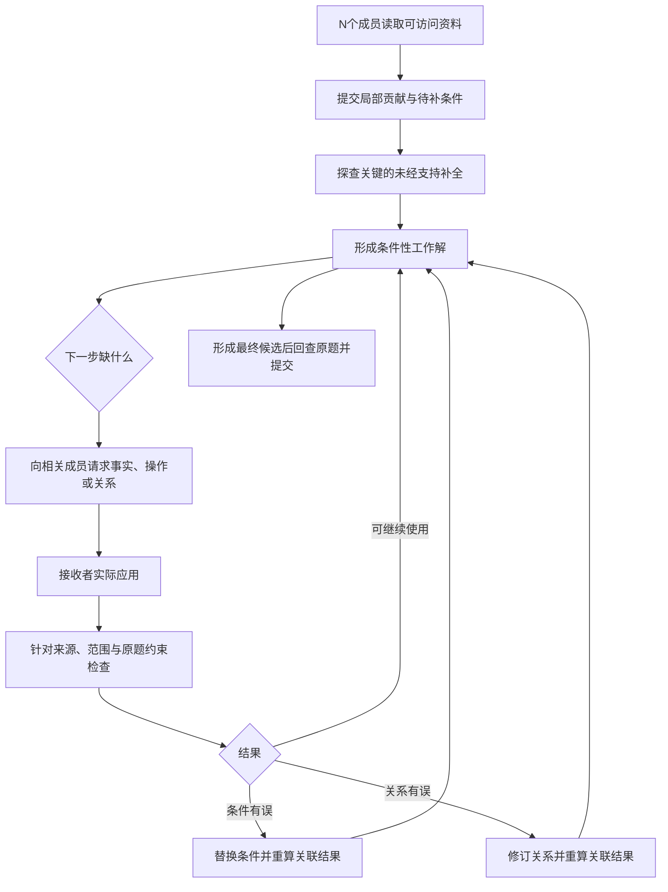

# CoReTA 命题与架构设计基线

日期：2026-10-21。承接 2026-10-20 机制假设、近邻比较及比较尺度校正。本文固定研究中心与概念级执行设计；未修改运行代码，未运行测试或模型实验。旧固定角色实现继续作为历史原型，不自动代表本架构。

后续实现入口：[局部贡献协议v1交接包](protocol-v1/README.md)。该包已把按需局部处理具体化为提示词、消息结构、调度和失败规则，包含真实公开任务上的手工轨迹；没有运行新模型实验。本文保留主命题及设计演进背景，具体实现规则以该包为起点。

执行负担补充：第2项缺口发现与第5项争议处理已单独审核，提出保留贡献/依赖对象、采用通常求解路径并按事件触发局部处理的候选变体；逐贡献强制探测和逐步第三人复核不作为已冻结要求。详见 [缺口与争议复杂度审核](GAP_AND_DISPUTE_COMPLEXITY_REVIEW_20261021.md)。按需探测效果尚待验证，本文原流程保留为此前设计记录。

## 1. 固定三个层次

### 1.1 研究主命题

**如何让多智能体团队可靠利用成员的任务相关专长，保留和应用有效局部知识，并在需要时组合不同贡献，提高整体解题能力？**

成员差异可以集中在一个专家，也可以部分重叠或分散互补；不要求事先人为安排成互不重叠、恰好拼成整解的专家拼图。互补是重点研究情形及可能的协作结果，不是架构运行的硬前提。没有有效差异的同质团队也允许运行，但收益需要单独验证，不能承诺通过协议创造缺失知识。

可靠利用包括保留原本有用的贡献、纠正错误贡献，以及用多人的局部知识构造新解。目标是减少无依据折中及知识流失，在适当问题上产生单个成员独立初答未得到的正确答案。既关注原本有人答对的题是否被损伤，也关注观察到的初答全错题能否恢复；不要求每一道全错题都被救回，也不把多数同意当正确。

研究类型定位为 Technique Paper。相关问题已有研究，贡献路线是解释并干预其中一个具体瓶颈，提出协作架构及对应证据；不将“发现专长利用问题”或“群体能超越个人”作为本项目首创。

### 1.2 待检验的机制解释

**要求局部知情成员过早形成完整答案，可能把有效局部知识与无依据补全绑定，使团队围绕完整立场进行协商，导致可组合的知识被误判为冲突或随错误答案一起丢弃。**

这是本项目选定的研究假设，尚未由旧实验或原始锚点论文证明。旧失败说明正确中间贡献可能未被正确使用，但没有建立专长差异的操控，也没有识别该机制的因果效应。

[Multi-Agent Teams Hold Experts Back](https://arxiv.org/html/2602.01011v4)提供专长利用和折中的问题依据；[SAT](https://arxiv.org/html/2609.22682v1)已展示部分推理的修复与组合。二者都值得比较，不能直接替当前机制假设提供实证结论。

### 1.3 架构核心思想

**让成员先交付有依据的条件化局部贡献，围绕尚未满足的依赖组织协作，并在条件改变时局部修订其应用结果。**

由此固定三个架构决定：

1. 协作的基本对象是局部事实、关系或操作及其适用条件；成员首次通信不强制提交整题答案。
2. 谁接续、接续什么，由当前解法缺少的条件或操作决定；成员头衔和初答票数不赋予整题权威。
3. 条件值、关系本身和实际应用分别管理；一个条件被否定，不连带抹掉与其无关的知识。

成员可以探索完整解，也可以提交完整候选作为参考；这里不强制完整初答，也不禁止整题探索。团队采用的具体依据需要明确支持、范围与未决依赖。推理时是否尝试整题与交流时以什么为采用单位，是可分开的设计维度，不能预设禁止整题推理一定更好。

## 2. 研究设定：什么才算互补专长

成员 i 有可访问资料 D_i、可用工具和推理能力。D_i 可以完全相同、部分重叠或各有私有部分。某个成员在当前所需事实、关系或操作上具有相关优势，才具有这一步的专长。资料持有权只说明可访问什么，不保证理解与推理正确；总体最强模型也不保证对每一步最可靠。

三类任务状态均允许出现：

| 状态 | 架构需要做的事 |
|---|---|
| 某人已经有完整正确解 | 保留其中有依据的关系和结果，阻止无依据折中，并允许具体反证纠错 |
| 无人完整答对，但若干局部贡献可用 | 找到依赖接口，用不同成员的贡献形成新解 |
| 团队现有知识仍不足或共享错误 | 允许继续推理和取证，保留未决，最终按任务要求提交最佳努力答案 |

首个三成员原型沿用已接入的 DeepSeek 配置，采用三个独立上下文；先通过可核对的资料访问差异建立信息互补，不以三个角色名称冒充三种专长。后续能力互补须另用独立资料或校准任务刻画，不能用测试题正确答案指定专家。

受控资料差异用于识别机制，单凭这类结果只能支持相应设定。泛化评估应包含集中优势、部分重叠、自然差异及低差异条件；不能把精心构造的完全互补结果外推为普遍收益。成员数 N 是配置，三人仅为首轮开发选择。

证据层级：任务相关差异是主要研究情形，包含集中优势和分散优势；低差异条件用于检查退化与损伤。允许某种配置运行，不等于已取得该配置上的增益，也不把所有配置都获益设为主贡献要求。

本方法适合能产生局部事实、关系、计算操作或条件性判断的任务。它不要求所有自然语言都转换成形式逻辑，也不假定任意开放式任务都能如此分解。

## 3. 共享对象与需分别评估的不确定性

### 3.1 最小贡献对象

一份贡献只需表达以下内容；程序负责原文、ID 和版本，模型不维护历史索引。

| 内容 | 含义 |
|---|---|
| 局部内容 | 事实、条件关系、可执行操作，或有限候选分支 |
| 适用范围 | 对象、时间/版本、单位及必要任务条件 |
| 已有支持 | 输入原文、可见工具结果，或可检查的模型推导；注明实际支持来源 |
| 待补依赖 | 尚缺的参数、事实、条件或操作；不把研究者未提供的答案填进去 |
| 应用位置 | 该贡献将改变当前解法的哪一步、产生什么中间结果 |

模型内部知识允许作为候选贡献。它没有外部出处时保留“模型推导”的真实身份，不伪装成已核实事实，也不因缺少出处而全部排除。事实可没有待补输入；条件关系可以在前件未满足时继续与其他关系组合，产生仍有条件的中间对象。

### 3.2 分别管理两类不确定性

术语细化：前文“条件”是依赖的统称，实现时要分开记录输入事实/参数、适用前提及范围。“关系”是连接输入与结论的推理规则、算法或操作，不特指数学等式；“应用结果”是具体执行或代入的产物。这些层次在自然语言中可能交织，分解是候选表示而非总能唯一完成的解析。

- **条件是否成立**：例如相关系数 rho 的真实取值未知。
- **关系是否可靠**：例如方差传播公式是否漏项、适用范围是否正确。

取得 rho 不会自动证明公式正确；公式正确也不会使猜测的 rho 变成事实。元数据齐备、条件引用闭合、同伴认可都不构成真值证明。

### 3.3 两种不同更新

| 新发现 | 更新动作 |
|---|---|
| 参数/事实归属错误，但局部关系仍受支持 | 撤回该取值及其下游实例，保留关系，重新请求和计算 |
| 关系被同条件下的反例或推导检查否定 | 修订或撤回关系及依赖它的结果；无关事实继续保留 |
| 仅适用对象、版本或单位不同 | 先对齐范围，再决定是否真的冲突 |
| 无法判别 | 保留候选分支和争议，不以票数将其升级为事实 |

这一区分是本架构的核心控制依据。追踪来源和依赖服务于它，不作为额外独立创新模块。

这些层次不构成互斥错误类别：条件可以被写进规则，同一失败也可能涉及多个层次。模型无需先唯一判定错误类别才允许修订；应说明改哪项输入、前提、关系或应用、依据是什么、显式影响哪些结果。无法定位时可保留多个诊断。这是一种组织核查和修订的表示，不是正确分解的保证。

## 4. 三个相互衔接的功能

### 4.1 条件化贡献生成：暴露未经支持的补全

输入：公共任务、成员自己的资料与工具、当前需要推进的目标。输出：局部贡献、未决依赖及依据。

具体步骤：

1. 成员先列出与目标相关的局部关系/事实/操作，并展开最短的必要推理；允许“目前只能推出条件性结果”。
2. 检查推理实际使用了哪些输入，将其分别链接到已有资料、推导或暂定假设。无法链接的条件优先成为缺口候选。这里的提取由模型完成，可能漏项。
3. 对可能影响目标、又无支持的关键赋值提出一个局部对比：在保留已有资料的前提下，选择两种合法取值或解释。已明确给出的事实不允许被当作未知变量任意改变。
4. 成员在两个条件分支中推演，指出哪些结果随条件变化，随后独立表达所用关系与适用范围。不能只凭两个输入输出点外推任意通用关系。
5. 把未经支持的默认取值从正式应用依据中移开，保留仍有依据的关系与未决接口。合法分支无法构造时记录限制，转向索取资料或直接检查关系。

候选条件来自资料依赖、当前推理、不同候选贡献的分歧，不由研究者事先标完所有关键槽位。每份初始贡献草案暂定最多探测一个会影响目标的缺口；后续按实际争议再触发，避免为所有可能假设穷举分支。这个数量是可实现默认值，不是最优性结论。

输出变化只能表明候选依赖；输出不变也可能来自忽略条件或共同错误。此过程不能保证所有局部关系有效。该风险必须通过具体反例、原始约束和后续应用检查继续处理。[ICE](https://arxiv.org/html/2311.08718v2)是条件变化探测的直接参考，不借其不确定性分析宣称知识真值。

### 4.2 按缺口接续协作：确定谁来补什么

输入：贡献池、当前解法、通向目标的显式未决依赖、资料/工具访问目录。输出：一次局部请求及其回应，或一条新条件性推导。

一次请求固定说明：当前要完成的步骤、已有局部关系、具体缺项、需要何种交付。接受的回应包括带来源的事实、执行结果、带推导的操作，以及引入更小缺口的条件关系；不要求每个人重新解整题。

临时规划者先选择阻塞当前候选解法的一项缺口，按以下默认顺序找接续者：

1. 找声明可访问对应记录、文件或工具的成员；目录只提供访问线索。
2. 没有直接资料持有者时，找已贡献相关关系或具备独立校准能力线索的成员。
3. 仍无明确人选时，向其余成员提出一次范围明确的求助；允许“没有支持”，不强制制造答案。

资料归属、语义相关性或能力线索可能判断错误，故路由不是专家真值 oracle。待补条件对应推理任务时，可以交给原提供者继续推理，不机械要求每次换人。双方互相依赖尚未落地的条件时保留为未决，循环引用不能自我证成。

条件改变可使当前解法失去价值；规划者允许转用另一条有支持的推理路径，不是无限补齐最早选择的路径。选择阻塞点、匹配自然语言接口由模型完成；程序执行预算、请求归属和显式依赖检查。

### 4.3 按依赖应用与修订：将贡献变成实际结果

输入：条件关系、得到支持的输入/假设、待推进步骤。输出：实例化的中间结果、后续求解变化和核查意见。

1. 接收者明确绑定对象、参数、范围与所用关系，执行计算或推理，并写出实际中间结果；只复述规则不算应用完成。
2. 具备相关依据的其他成员或可用工具针对“来源是否匹配、适用条件是否满足、操作是否正确、是否违背原任务约束”提出具体检查。三成员原型可优先请第三人执行；无需每一步强制安排一个专职第三人。规则提供者可另核规则使用，资料持有者可核记录绑定；这些检查仍可能出错。
3. 检查发现参数错时换参数重算；发现关系错时修订关系；同条件下两条关系冲突时寻找具体反例或独立证据，不平均输出。
4. 版本更新使显式下游实例过期，重新计算；保留不依赖失效内容的支持。自由文本的依赖可能漏记，最终仍需回到原题检查整体输出。
5. 最终提交者按实际存活的推导生成答案，并核对原始目标；角色本身不赋予其推翻有依据内容的权威。

数值/代码等任务若提供执行工具，检查只使用运行时可见输入，所有对照拥有同等工具权限；隐藏测试和金标准只供离线评分。没有工具的语义关系仍可由模型推导和交叉检查，不能称为已形式验证。

## 5. N 个 Agent 如何承载这套架构：首轮使用三个

所有成员均为贡献者。提供、请求、应用和核查是围绕当前贡献发生的执行动作；提供者、接收者和复核者是对动作承担者的临时称呼，不是三类固定 Agent，也不对应三种专长。一个成员可以在不同步骤交换角色，一步可以有多个提供者和使用者。

N=2 也可交接、应用与相互检查，缺少额外第三执行者；N=3 便于观察提供—应用—复核及职责交换，因此作为首轮原型；N>3 可由多个相关成员共同提供和核查。增加成员不自动增加独立性或正确性，复核本身须有相关证据。

| 职责 | 分配依据 | 权限 |
|---|---|---|
| 临时规划与最终提交 | 在N名成员中分配；首轮三人原型可按固定顺序轮换，便于复现 | 提议下一步骤、请求和候选解法，无额外事实可信度 |
| 局部提供者 | 资料访问、工具或当前有效贡献的相关性 | 提供事实、关系、操作及其支持 |
| 接收与应用者 | 正在推进依赖该知识的步骤的人 | 实际应用并暴露仍缺什么 |
| 当前步骤复核者 | 按相关依据和能力线索选成员或工具；记录自审/交叉检查身份 | 提出具体核查与反例，不凭“认可”赋真值 |

提供者与接收者可以是同一人，其余适合的成员可承担取证和复核。程序不承担额外推理成员的角色：它管理消息、原文、版本、显式依赖、预算与日志；它不识别所有自然语言谬误。N成员接口是当前设计目标，具体调度与人数扩展效果尚未实现或验证。



### 5.1 概念级执行协议

```text
收集各成员的局部贡献；为关键未知赋值执行一次合法对比探测。
建立候选工作解及其显式待补依赖。
循环：
    若有可完成的候选：实际生成答案并检查原题；符合任务要求则提交。
    若存在目标相关缺口：临时规划者选择一项，路由给相关成员。
    收到支持后：由接收者应用，另一成员针对实际结果核查。
    按条件错 / 关系错 / 范围不一致分别修订；使关联实例过期。
    无法推进时尝试另一条有依据的候选路径。
    重复相同请求且无新增支持，或达到预设推理预算时结束循环。
最终仍提交最佳努力答案，保留未决说明；离线按同一标准评分。
```

初始原型可用三次接续循环、每次最多一次针对新结果的修订作为可执行默认上限，后续冻结前确认预算；超过预算不无限追求成功。贡献池可以存多个条件性候选，不能将所有成员的断言直接硬取交集。

“显式依赖已闭合”只表示程序未看到未填接口，不能保证没有隐含条件或错误规则。若需要使用暂定假设才能完成最佳努力答案，保留其暂定身份；不把它写成已经核实，也不靠拒答或剔除失败改善成绩。

## 6. 一次完整纸面示例

以下为自构设计说明，没有模型输出，不作为实验结果。

公共任务：P/Q/R 方案分别费用 1/2/3，每个方案取两个无偏测量的等权平均；两项误差各自方差为 9。要求结果方差不超过 5，并选择费用最低的可行方案。

| 成员 | 掌握的局部材料 | 应提交的贡献 |
|---|---|---|
| A | 误差传播关系，无配置记录 | V=4.5(1+rho)，说明等权及方差条件；rho 待补 |
| B | 各方案记录，无完整统计推导 | 带标识记录：rho(P)=1、rho(Q)=0、rho(R)=1/2 |
| C | 公共目标，承担当前应用与提交 | 将同一关系与各配置绑定，检查可行性，再比较费用 |

完整流程：

1. A 不需要猜一个 rho 并先选方案。对未知 rho 比较 0 与 1 时，V 分别为 4.5 与 9，说明当前数值结论依赖该条件；公式的依据仍来自其推导，不能由两个点反推公式。
2. 当前工作解需要各方案的 rho，临时规划者向 B 索取带方案身份的记录。
3. B 提供配置。C 实际应用，得到 V(P)=9、V(Q)=4.5、V(R)=6.75，因此仅 Q 满足约束，选择 Q。
4. A 核对公式的应用与运算；B 核对方案与参数的归属；最终文本回查阈值和费用要求。
5. 若 Q/R 的配置被错绑，撤回相关实例并重算，保留公式。若某人声称相关性不影响方差，则检查关系本身，例如两个误差完全相同的边界情形，不能只换一个 rho 继续沿用错误关系。

这个例子表明接口如何工作，不表明架构胜过直接合并资料。直接资料集中与普通讨论同样可能正确，未来须允许它们成功。自然任务还会出现关系、条件、资料身份均有争议的情况，这些才检验语义与控制机制。

## 7. 创新位置及文献关系

本项目当前选定的贡献方向是：把局部知识在形成完整立场之前作为可接续对象，使依赖探测、定向补足、实际应用和局部修订围绕同一对象运转。可检验的预期是：成员修正未经支持的补全时，仍能保住和使用原本有效的知识，从而减少损伤并增加组合求解机会。

- [SAT](https://arxiv.org/html/2609.22682v1)学习组织策略，也已有局部修复与组合。需对比具体交流对象及更新方式，不能以共同目标判整体重复，也不能仅以手工设计/学习不同判定机制必然不同。
- [ICE](https://arxiv.org/html/2311.08718v2)可借鉴条件对比；探测信号在本架构中用于提出未决接口，而非直接认证规则正确。
- [AgentAsk](https://aclanthology.org/2026.acl-long.1294.pdf)可借鉴问谁、问什么；本架构需要把回复落到原有条件关系的实际应用与修订。
- [AAMAS 2012 条件论证](https://www.ifaamas.org/Proceedings/aamas2012/papers/4C_2.pdf)及 [ATMS](https://dekleer.org/Publications/Corrected%20AAAI88.pdf)提供条件接续与替代支持的基础语义。它们是思想/形式操作前身，当前方法须处理不完美自然语言贡献，不照搬其形式保证。

这些基础操作可以复用。预期创新不以三个模块分别首创为条件，而以信息对象、控制机制及其对应的失败解释为整体判断。尚未声称已有足够投稿效果或完整查新证明。

## 8. 架构对未来验证的要求

此处只固定设计需要回答的问题，不选择或启动数据集实验。

1. **差异真实存在**：成员的资料/工具访问和能力线索可核对；角色标签不算操控。先区分信息互补与能力互补。
2. **机制解释成立吗**：比较完整答案式交付与局部条件式交付，检查无依据补全、有效关系保留和实际使用是否发生变化。不能由最终准确率直接推导原因。
3. **能力是否改善**：报告总体准确率、原本有正确初答时的损伤、观察到的全员初答失败恢复；允许收益和损伤同时存在，不要求逐题支配。
4. **组合是否真的起作用**：依据实际关系、输入绑定和中间结果的变化分析，不凭引用数量、resolved 标签或最终答案不同认定。
5. **替代解释受到控制**：集中全资料单体、资料直接合并、普通讨论、直接提示局部贡献、定向澄清/SAT式修复，以及追加独立推理，都有各自作用。信息和工具权限可比，成本先作为报告项。

为统计初答覆盖，可在与方法流程隔离的独立分支中记录各成员完整作答；这些答案不必输入本架构。全员初错指实际采样结果，不等于成员绝对没有解题能力；新增诊断调用计入并单列，不能隐藏成免费推理。

## 9. 逻辑链模板与审查

### 9.1 思考模板

| 环节 | 固定内容 |
|---|---|
| 背景 | 团队有相关且不完美的差异；公开研究提示专长利用、知识探索和组合均有瓶颈 |
| 局限 1 | 完整答案作为主交流对象时，局部关系与未知部分补全可能绑定；这是待检验的特定机制，不是断言所有近邻如此 |
| 局限 2 | 对整份答案作采用/放弃，难以分别处理条件值、关系和应用层的错误；SAT等已有局部修复，比较应落实到更细的控制规则 |
| 核心想法 | 以条件化局部贡献为对象，用待补依赖驱动协作，并局部修订其应用 |
| 挑战 1 | 成员可能不知道自己填补了什么；仅自报知识边界会漏项 |
| 挑战 2 | 缺口需转成别人能接手的问题，同伴也可能给错或引入新条件 |
| 挑战 3 | 条件纠正与关系纠正影响不同，且解释被复述不代表被正确应用 |
| 方法总句 | CoReTA围绕条件化贡献的生成、接续和应用修订组织N成员协作，首轮原型用三人 |
| 模块 1 | 条件化贡献生成，对关键未经支持赋值作合法对比探测，回应挑战1 |
| 模块 2 | 按缺口接续，匹配相关访问/能力并允许继续引入条件，回应挑战2 |
| 模块 3 | 实际应用并按依赖修订，区分两类错误和范围错配，回应挑战3 |
| 预期贡献 1 | 刻画并检验整答承诺与局部知识流失的机制假设；未来分析节，不提前声称发现成立 |
| 预期贡献 2 | 给出以条件化贡献为对象的三功能闭环及调度/修订规则；方法节，覆盖模块1–3 |
| 预期贡献 3 | 在相关差异设置下评估能力保留、恢复与实际利用，区分追加推理等解释；未来实验节，尚无结果 |

### 9.2 四项一致性检查

1. 局限→核心想法：逻辑对应。先交付局部贡献降低过早补全压力，分层更新回应整体采用/放弃的问题；是否有效待验证。
2. 核心想法→挑战：逻辑对应。条件贡献自然带来边界发现、同伴补足和应用修订三个困难。
3. 挑战→方法：三对三对应。每个模块均有输入、输出、动作及判断责任，未把语义正确性交给程序黑箱。
4. 方法→贡献：设计与预期证据对应。当前交付仅是设计；机制发现和能力收益均列为后续验证目标，不作为已完成贡献。

逻辑链的结构对应成立，但不代表关键技术决策已经完成。MAJOR未决设计包括缺口触发/合法分支判别，以及争议后保留、修订或换路径的具体依据；它们直接决定如何使用专长，不能仅归为提示词或接口细节。当前已有操作路径和模型/程序责任，仍需将可见输入、判断依据、动作与失败后果写成操作协议，再冻结接口。主命题保留，不据此宣布方法无效。当前不进入论文 Introduction 起草。详见 [本轮审核](DESIGN_CLARIFICATION_AUDIT_20261021.md)。

方法节可按三小节展开：条件化局部贡献的取得；按依赖接续互补成员；实际应用、冲突处理与局部修订。下一步将本基线用于正常接续、错误条件、错误关系、循环依赖与资料集中已足够等场景的协议审查，再冻结实现接口。

## 10. 机制来源与本轮澄清

机制形成的证据层级：

1. 原始问题来自 Experts Back 的专家利用与折中研究，它没有证明本项目的“整答补全绑定”机制。
2. 项目旧实验出现中间约束与后续对象不一致、检查认可错误对象等现象，支持继续研究有效内容如何被使用。见 engineering/CONVERGED_FLOW_REPORT_20261020.md；尚未操控初答形式，不能据此断言过早完整作答是原因。
3. “完整答案把局部知识与补全绑定”的因果解释，是在用户要求提出更具体 insight 后形成的研究推论，首次记录于 research/expertise-architecture-20261020/INSIGHT_HYPOTHESES_20261020.md。手工示例解释了其逻辑可能性，不是模型证据。
4. 后续近邻核对中，ICE提供条件变化探测的具体参照，条件论证/DAREC2提供条件接续的形式前身，ATMS提供依赖支持与局部撤回的基础，SAT提供现实LLM局部修复与组合的比较。不能把后续检索命中的论文追写成已证明该机制或唯一的最初来源。

该假设是主线下的候选干预解释；若验证不成立，仍需研究专家利用，且不能把全部旧失败强行归于它。当前设计保留“局部贡献及其实际利用”的研究对象，人数与职责随配置及当前缺口变化。
