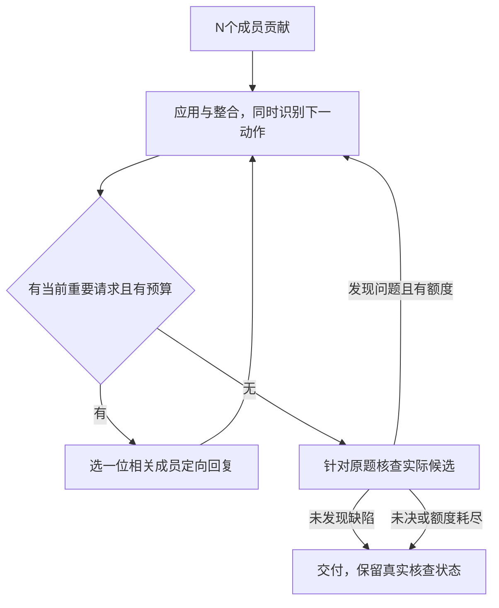

# 执行规格

日期：2026-10-21。依据最新设计及缺口/争议复杂度审核。以下默认值供原型实现与查验，未声称最优。

## 1. 输入、成员与权限

输入为公开任务T、成员列表及每人的可访问材料。T保留完整原始要求、入口和公开例子；私有材料可为空、相同或部分重叠。目录仅说明成员能访问的材料/工具范围，不包含测试题正确率或专家真值标签。

首版沿用 config/deepseek_flash_inspection.json 的provider/base_url/model及generation设置，不改模型别名含义；本包参数只是调度/阶段输出预算。密钥沿用环境变量读取，不写入包或输入。现有DeepSeekClient可作为后续复用对象，本轮没有检查服务可用性。

N≥2。应用者driver取agent_ids[task_ordinal mod N]，同一道任务中保持应用上下文连续；换任务轮换。它负责下一动作和最终候选，无额外知识权威。其余成员仍可贡献、回复或核查；driver也可回复自己的局部核查请求。

首版所有调用无执行/浏览工具、无隐藏历史、无金标准。公开代码例子的值可以手工推演，必须说明未执行。后续若增加工具，另设同权限对照。

## 2. 引用和状态：程序维护，模型只用已有句柄

| 对象 | 程序记录 | 模型责任 |
|---|---|---|
| 任务/材料 | T、S1…；正文与可见权限 | 引用实际可见内容 |
| 贡献 | C1…；作者、原始payload、产生事件 | 提交局部内容、支持、条件与缺项 |
| 工作解 | W1…；完整artifact、应用说明、排除说明、输入引用 | 生成实际结果，说明如何使用贡献 |
| 核查 | V1…；对象、具体观察、范围和模型判定 | 给出实际检查及其局限 |
| 请求 | Q1…；来源、目标、接续者、计数 | 提出具体缺项/疑点和任务后果 |

所有引用在响应解析后由程序分配。模型不生成事件号、版本号、历史数组或changed_step_ids。输入为本阶段可见引用表；结构字段引用只能选已有句柄，不能引用本次输出尚未产生的编号。

贡献正文不可就地覆盖。修正通过新贡献或工作解的推导追加，原记录保留。`excluded`只说明当前工作解不采用哪一部分及原因，不永久删除来源，也不自动将整份来源判错。同一来源可能一部分被使用、另一部分被排除，须在文字中指出不同部分。

`applications`记录本次实际应用，程序对未变artifact保留此前应用记录，并将本次记录追加；它不是要求模型重抄全部历史。程序从声明的refs记录来源边，但不声称得到完整语义依赖图。当当前依据受到具体质疑时，当前候选标为待复查；重新应用后产生新版本。首版不做自由文本的精确自动局部重算。

保留知识的粒度是独立贡献；工作解可整体重新生成。这样先实现“错误实例被修改，仍可继续用其他贡献”，不让模型手工维护细粒度证明图。

## 3. 四种调用及输入视图

| 调用 | 输入 | 输出定义 |
|---|---|---|
| CONTRIBUTE | T、自己的材料、目录、本成员身份 | ContributionOutput |
| APPLY | T、driver材料、所有已公开贡献、当前工作解、当前相关核查/回复、计数与合法动作 | ApplyOutput |
| REPLY | T、接续者材料、具体请求、相关贡献与当前工作解 | ContributionOutput |
| REVIEW | T、核查者材料、最终候选、所用贡献、未决项 | ReviewOutput |

无独立的规划调用。APPLY在执行求解时同时决定需要何种接续。REPLY的用途为ask/check/probe，使用同一小结构，不新增角色专有schema。

初轮各成员最多3条贡献；一次REPLY最多3条。允许完整候选作为参考，但CONTRIBUTE不要求完整代码或整题答案，代码最终交付由APPLY的artifact承担。

公开贡献池保留原文，首版上限较小，直接加载全部已公开贡献；只加载当前工作解、相关核查，不不断累积所有旧完整答案。私有材料只对其持有者可见，目录不泄露正文。输入超预算则记录context_overflow，不静默截断原题或凭摘要替换源事实；原型暂不新增检索/摘要Agent。

## 4. 第2项：缺口发现的操作规则

### 4.1 不额外调用的初筛

CONTRIBUTE需说明自己仍缺什么。APPLY在实际执行当前步骤时检查：所需输入与操作是否已有；哪些关键前提只是暂定；是否存在与原题要求不符的结果。没有外部引用不自动成为缺口，内部知识或局部推导可以作为候选支持。

每个额外请求必须给出：`question`具体要什么，`impact`阻塞/可能改变哪一步，`target_refs`指向相关贡献或工作解；无对应句柄时可空，并在question定位原题内容。缺项可以是事实、参数、能力/操作或可判别依据，不能只填参数表。

### 4.2 一次只推进一项重要请求

1. 已知缺少的资料/操作可取得，使用ask；同一成员可一次回复的相关缺项合并。
2. 同对象同前提下的结果冲突、计算不一致或原始要求被违反，使用check。
3. 怀疑某个未经支持的隐含赋值影响结果、尚不能直接指出真实缺项，使用probe。请求必须说明保留哪些已知事实、比较什么未知前提、观察什么结果；不能修改题面。
4. 无具体阻塞或疑点时完成求解，不制造请求以填满流程。

这不是程序判真：模型判断影响性和接口语义，程序只检查请求是否包含必要说明。若两个问题都重要，优先当前下一步必须使用的那个；无法区分时按出现顺序处理，避免另造未校准的数值优先分。

probe回复可给两种合法解释/取值及简短推演；合法性无法论证时明确无法完成，不强行产生两个世界。变化仅提供依赖线索，不认证关系正确，也不允许两个点外推出通用规律。

## 5. 第3项：路由规则

APPLY可提出`recipient`，只允许目录中的成员或null，并说明理由。程序按下列顺序落实：

1. 请求明确索取资料时，driver应根据目录提出可访问者；程序验证成员ID与实际packet权限，不声称能从自由文本自动识别所有资料需求。误选了无法帮助的成员时，该成员正常回复items=[]并说明限制；这属于求助/路由未奏效，不占用格式恢复额度。
2. 请求澄清某份贡献且作者可回应时，优先原作者。
3. 其余有效recipient直接使用；相关性是模型提案，不是程序已知的专家标签。
4. recipient为null时，从非driver成员中按本任务已回复次数少、成员顺序小选择。找不到相关专长时只是有界求助，不称已找到专家。

check/probe优先有相应材料者；其余条件相同可选非主要作者。没有独立者可用时如实记录自审身份。每项请求只找一位接续者，不自动全员征询；回复明确不能帮助时，driver可提出有理由的改派，计入总干预预算。成员ID无效、引用不可见才属于结构/权限校验错误，不能把选人不合适与JSON错误混为一谈。

## 6. 第4项：实际应用与版本更新

收到回复后必须进入APPLY。driver对本次使用的来源输出`applications: refs + result`，说明具体绑定、计算、代码操作或后续决策。回复无用或被反驳时，用`excluded`写出不采用的部分及原因；不要求为了显示协作有用而强行改答案。

每次APPLY可生成完整artifact，也可在尚未完成时返回null并提出请求。null不抹除已有完整候选；有新的完整artifact才产生W新版本。程序计算文本是否变化，不让模型自报changed_step_ids。

APPLY的unresolved保存本次更新后仍有影响的未决，供后续packet和最终状态使用。贡献Item.needs是原始条件性声明，不被程序当作必须逐一关闭的硬槽位；它可能已在实际应用中满足。unresolved=[]也不证明所有隐含依赖已解决。新回复/核查必须在applications或excluded有对应引用和处理说明；程序只标注是否有处理记录，不按关键词resolved赋真值。最终核查未发现缺陷但unresolved仍非空时，交付状态保留best_effort_unresolved。

对发生具体质疑的来源，不以“所有人同意”为解除条件。新工作解须实际回应质疑涉及的输入、操作或范围；程序检查有对应记录但不裁定其数学真实性。当前应用记录不变或只有复述，标明“模型声称应用，未由内容独立确认”，不能作为研究中的互补成功标签。

## 7. 第5项：争议的有界处理

一项check/probe请求需指出具体对象、任务后果以及已有依据或建议检查。质疑者无须先证明对方错。接续者先对齐对象/单位/前提；能直接消除表面分歧则说明后回复，不另开讨论。

否则只选一项最相关检查：读可访问原文、局部重算、检查具体推导或构造最小反例。回复记录观察结果、理由和局限。首版不能伪称执行了代码；公开例子可手工推演。

随后driver在APPLY中：

- 更新被反驳的输入或操作，保留仍可支持的关系和其他贡献；
- 也可同时修多层错误，不强制唯一分类；
- 若缺少判别依据，保留一个当前工作解与争议处局部备选，不枚举完整组合；
- 若当前路径无法推进，可换解法。原有有效贡献仍保留，允许新路径重新使用。

跟进需指出新回复留下的具体缺项/新的判别依据，通常一次补问后应换路径或保留未决。首版不设置需要识别自由文本“同一问题”的独立硬计数器；所有首次请求、补问和改派统一计入最多3次定向干预。程序对相同target_refs集合与question的空白规范化文本做精确去重；语义改写可能绕过文本去重，由总计数保证有界，不能宣称完整检测语义重复。

## 8. 第6项：调度、预算、终止与失败

初始CONTRIBUTE完成后调用APPLY。若request不为空且有干预预算，执行REPLY→APPLY；否则进入最终REVIEW。reviewer优先从非driver中选择：先看其可访问材料是否覆盖当前候选显式引用的来源，再按本任务已执行REPLY次数少、成员顺序选择。这里的覆盖只按已登记来源权限计算，不推断未声明的语义相关性；没有来源权限差别时直接用后两个排序项。无法独立核对原材料时记录限制，不以“参与少”等同具备核查能力。

只有存在完整artifact才进入最终REVIEW；没有完整artifact且无法继续请求时直接记录artifact_missing并结束，避免对空答案反复核查。items=[]是合法的无法帮助回复，note需说明具体限制；数学错误、未能找到关系或能力不足不转化成格式恢复。APPLY输出null且已有完整候选时保留该候选，但当前未决不能因此消失。

REVIEW每次只提交一个最影响结果的发现，必须针对原题的实际输出与依据；不重新逐条审计整个协议。结果分no_defect_found / issue / undetermined，均为模型判断。

- no_defect_found：交付当前artifact，状态reviewed_no_defect；不称外部已验证正确。
- issue：若还有调用额度，反馈driver进行APPLY。第一次核查后的修订可再核一次；最后一次核查后的修订如无法再核，标best_effort_unreviewed，不以旧核查背书新版本。
- undetermined：记录具体未决；有明确可完成检查且还有干预预算时交driver选择请求，否则交付最佳努力版本。

原型默认：最多3次定向干预，最多2次最终核查；所有网络尝试含传输/格式恢复共最多20次，每阶段最多1次格式恢复及1次传输重试。临近总上限时停止非必要干预，尽量为一次APPLY和一次REVIEW预留两个首尝试槽位；恢复额度耗尽可能仍使最后核查无法进行，必须保留真实状态。

不以投票、更高自报信心或字符串resolved结束争议。无新增依据/预算耗尽可结束求解，但未决仍记录。最终选取最近一个结构可解析的完整工作候选；不能用隐藏评分挑历史最佳。若新候选只部分修改，必须仍输出完整代码/答案，格式组装不由旧片段猜测。

无完整artifact则artifact为空并计交付失败。格式错误只按具体字段/JSON位置反馈一次；不得静默删除未知字段、自动替换引用或放松契约。最终状态为protocol_failure、budget_exhausted、best_effort_unresolved或best_effort_unreviewed等，保留实际候选与失败原因；这些状态不改变离线同一评分规则。

## 9. 流程图与最小路径

三人无异常路径是3次贡献＋1次应用＋1次核查，计划选择并入应用；这是设计路径，不是测得调用量。格式恢复、真实缺口和争议会增加调用，复杂任务不保证五次完成。

## 10. 后续实现映射与当前就绪程度

复用model_client.py的传输/原始请求响应日志、tasks.py的公开任务形状、离线评分入口。另建独立协议模块，不能将旧LeadUpdate、historical_cases、closure_reviews、changed_step_ids等字段带进本包。schemas.py的JSON结构校验方式可参考，但语义状态和schema独立。

schema提取采用现有Contracts.schema的思路：选择$defs中的阶段定义作root，仅带入其传递依赖，并把Ref/Agent替换为当前可见枚举；不能将仅含$defs的外层文件直接当阶段输出契约。私有原始材料句柄只在其持有者的引用表出现，公开回复引用它时，下游以该回复C句柄作为可见来源；目录条目不等于正文已公开。

上下文计数沿用现有客户端实际计数模式，包含全部系统提示和序列化packet；保守UTF-8计数可能比真实token计数更早触发上限，日志须保存模式。贡献与回复应短写，避免把完整代码反复塞进note；完整artifact主要只保留当前工作解。预算不足时真实失败，不静默提高输入上限或无记录截掉条件。上述原型参数未由运行测得。

实现需完成：packet组装、动态引用枚举、四阶段调用、请求路由、不可变贡献与候选版本、失败/预算处理及最终导出。这里已规定其输入输出和分支；模型对缺口、相关性与证据的判断仍可能失效，后续实测评价。当前可进入最小实现，不需要再增加固定角色；正式实验方案另行冻结。
