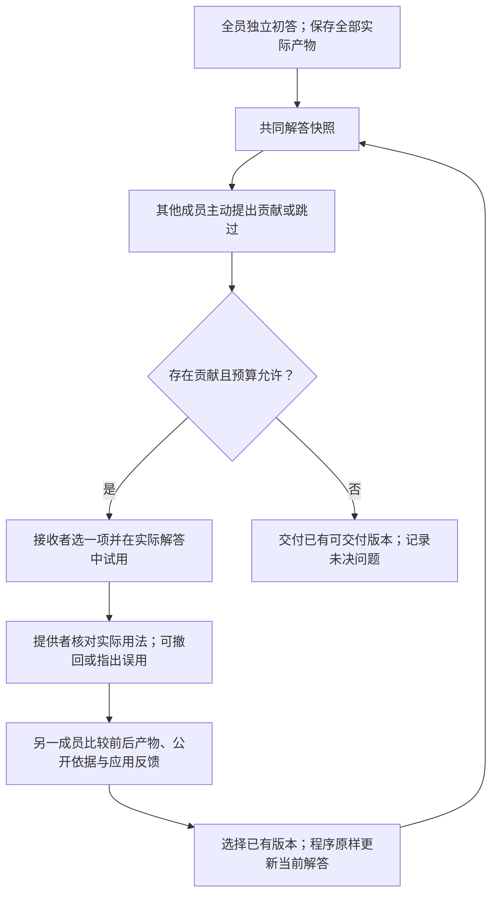

# CoReTA：整体流程设计与自审

日期：2026-10-22。状态：候选方案，尚未实现、尚未验证。本文不替换 workboard-v3 的运行规范，也不改变已冻结实验。先审查设计，再决定是否实现。

本日复核修订：主insight与实现变体分开。主线是围绕中间解答发现局部知识的用途，并借实际应用反馈修正知识与解题步骤之间的连接；“非应用者选择版本”降为次级实现假设。详见 INSIGHT_AUDIT_20261022.md。

后续设计状态：最新的首个隔离实现候选见 [分歧核对D0](DISAGREEMENT_MECHANISM_SPEC_20261022.md)。它优先检验关键争议怎样进入下一次实际修订，沿用v3选择者、调度与收尾。本文后续换选择者/去终检流程保留为历史候选，不应与D0混合实现或当作当前已确定运行规范。

## 1. 核心判断

研究问题保持：怎样让团队发现、正确应用并保留成员的有用知识，使不同成员的专长共同改善解答。

核心机制候选：**围绕共同解答提出具体贡献，在实际版本中试用，由提供者核对应用，再由未生成该试用版本的成员比较实际产物并选择下一版本。**

三个功能仍是共同解答、主动贡献、应用反馈；这次调整的是它们之间的决策关系。角色名称、来源校验和版本管理不作为创新贡献。

主要假设：中间解答让知识持有者更容易识别可帮助的位置；实际应用把接收者对该知识的理解变成可检查的对象，提供者能够据此补充条件、指出误用或撤回主张。双方共同修正知识与解题步骤之间的连接，可能提高有效知识利用。

次级实现假设：将试用与最终选择分开，可能减少当前编辑者围绕原答案自我辩护，也可能把瓶颈转移给另一位成员。当前日志不能确定哪个解释成立，不将换选择者作为论文核心洞见或已决定采用的架构修改。

## 2. 当前实现到底做了什么

源码依据：src/coreta/workboard/runtime.py、prompts.py、provenance.py。

当前完整路径：

1. 全员独立作答；固定编辑者的初稿成为当前版本，其他初稿保留。
2. 非编辑成员基于同一当前版本主动提出贡献。
3. 程序按尝试次数与轮转选一条；编辑者 TRY。
4. 提供者 CHECK_USE；另一成员 CHECK_EFFECT；两者同快照独立形成。
5. 同一编辑者读检查，CHOOSE 旧版或试用版。
6. 到期后一律 FINALIZE，再双检查，再由同一编辑者 FINAL_CHOOSE。

这里已经有实际试用与版本选择，不能把新增一句“比较前后”说成全新机制。

已观察：001-r2第一次TRY产生正确答案，后续修订保留；050-r1两次后果检查提出issue但仍保留错误版本，且存在来源视角混淆。证据仅定位失败发生位置，尚未证明编辑者兼任选择者就是失败的因果原因。

结果来源：refine-logs/workboard-evaluation-20261022/HIDDENBENCH_RESULTS_AUDIT_20261022.md。

## 3. 拟定的最小完整流程

一般路径没有额外的“终稿生成—再次双检—再次选择”。每一周期已经完成生成、核对和选择。结束后原样渲染已选产物。

### 3.1 成员与初始化

- 首个候选实现支持N=3或4；不是方法必须恰好三人。N=2无法分开提供者、接收者与比较者，需另列变体。
- 保持同模型、不同资料可见性的受控设置；角色不代表训练出的领域专长。
- 所有成员正常独立作答，完整/部分解答均可保存。初答对照共用相同实际输出。
- 按任务序号平衡指定本任务的接收者；初始化沿用其合法初稿，不按答案选稿。缺失时按固定顺序降级并记录。
- 所有初稿保留可读，不能因未成为当前版本就消失。成员可以直接提出复用一份初稿。

### 3.2 发现贡献：将知识接到当前工作

其他N-1人读取同一快照，独立提出至多一项具体帮助或pass。贡献可以是事实、条件、反例、局部操作、工具试验或完整已有候选；不要求贡献者完成整题或完整修复。

沿用最小内容：影响的位置、相关知识、支持依据、建议怎样使用。无需让模型预先诊断所有知识缺口，也不要求所有成员观点不同。

已有实质异议与处理结果随当前版本可见，避免每次从零开始。pass只表示本次没提出帮助，不证明解答正确。

### 3.3 实际应用：形成可以比较的产物

接收者在同一次APPLY调用中选一条当前贡献并实际使用，可新建版本或复用已有版本。优先处理会改变当前步骤、最终选择或未决实质问题的贡献；选择原因用短文本说明。程序不按金标准、专家标签或模型自报置信度判优先级。

这是对旧轮转调度的候选替换，仍会选错、仍可能饿死某些贡献；日志明确区分没选中、无法应用与应用后未保留。初版不再另加打分器、投票器或调度模型。

应用记录说明用在哪一步、实际改变及已观察结果；完整任务产物保留。对代码可以是可物化补丁及真实工具输出，对数学是实际式子/推导变化，对决策是候选选择及依据变化。解释不是执行证据。

允许拒绝不适用贡献，但必须给具体障碍。拒绝/无法应用也交给提供者回应；不伪造试用版本。仅写“已经考虑”不算应用，但也不因没有变化就自动判错。

### 3.4 提供者反馈：核对应用，不为自己背书

提供者读原贡献、前后实际产物及使用记录，说明哪些部分被正确使用、哪些发生误用、哪些条件缺证，也可撤回自己原来的主张。反馈必须允许“贡献本身有错”和“这里不适用”。

作者与检查者的身份、直接资料、公开转述分开标注；引用合法仅代表可见。另一作者work_text中的“我”绑定其作者，不绑定当前阅读者。程序提供元数据，不把作者能访问某原件等同于其解释正确。

这是修正现有接口歧义，不另设来源审查阶段。提供者可复述自己有权公开的原文摘录，但不能读取或获得其他成员原件。

### 3.5 比较并选择：把反馈接到版本变化

比较者为接收者和本次提供者之外的成员；多于一名候选时按调用次数平衡、平局固定轮转。比较者不是新增Agent，职责随贡献来源变化。

输入是任务及自有资料、实际前后产物、公开支持和提供者反馈。它在同一次调用中：

1. 指出真正影响选择/步骤的分歧及其依据；若只是来源格式等不改变答案，也明确说明。
2. 比较两份实际产物如何处理该分歧；必要时重算受影响关系或使用同等工具。
3. 选择已有版本，并解释为何保留/拒绝反馈。不生成第三份未经检查的答案。

常规候选为旧版和试用版；当本轮贡献明确引用已有替代Work时，该真实版本也可进入选择集合，避免两个错误试用版本把已有好答案排除。程序仅按合法显式Work引用扩展集合，不从自由文本猜候选，也不按正确性挑选。所有初稿仍在贡献入口可读，不是每次比较都穷举全部历史。

unable时不存在新试用版，比较者可以保留当前版本或选上述明确引用的已有版本；若没有替代，只记录应用障碍进入下一轮。不因提供者反对就自动切换版本。

输出维持“已有候选ID＋具体理由”。理由需要回应本轮关键异议，但程序只检查引用与候选存在性，不宣称能自动判断理由是否充分。

此步骤替换旧CHECK_EFFECT＋编辑者CHOOSE。比较者先接触提供者反馈，改变了旧双检查同快照独立的设计；好处是可以直接使用应用反馈作决定，风险是被提供者锚定。不能继续称双检查独立。

同模型的另一调用不等于独立能力或中立裁判；比较者也可能持有旧偏见。它不得对自己生成的本次试用版作最终选择，但可能是某个旧初稿的作者。三人条件下不能承诺完全消除利益/立场重叠。

### 3.6 停止与交付

- 首个候选实现仍用预先冻结的有限周期上限，不因失败临时加轮；可沿用N-1周期用于开发比较，但不声称最优。
- 全部pass、预算不足以完成一周期、达到上限时停止。已有实质异议不能被标为“已解决”，预算结束允许带着不确定性尽力交付。
- 当前已有可交付产物时直接提交，不新写终稿。形状合格不是正确；零贡献终止也不是通过审查。
- 若尚无可交付版本，可在预留预算内做一次完整“组装候选—用法核对—比较选择”，而不是启动第二套终检协议。没有合法产物则记交付失败。
- 若当前为不可交付中间版，但已有旧可交付版，沿用最近被实际选择的可交付版本作为中断回退，明确未经新一轮判断；不得按金标准挑旧稿。
- 自然实验首个技术异常仍停批；不得用无限恢复掩盖故障。

## 4. 通用的证据边界

在解答、试用和比较中区分：有来源的任务事实、模型推断、计划采取的动作、已观察结果。使用普通短语标明即可，不增加四套对象或知识图谱。

“未亲读同伴原件”不等于“该信息不可信”，公开的具体摘录仍可成为依据；“直接持有原件”也不等于“解释一定正确”。

新信息与旧信息冲突时，比较对象、范围和文本中的时间/版本依据；不硬编码“新的一定赢”或“私有一定赢”。计划补救在没有实际确认前仍是计划。它可以影响风险评估，不能被写成已完成的修复。

这些要求不是另一个创新模块，也不宣称提示能保证模型做到；用于让流程中的产物和比较有可检查含义。

## 5. 对旧流程的增删清单

| 旧实现 | 候选处理 | 原因 |
|---|---|---|
| 全员正常初答、共享初稿 | 保留 | 保留自然解题与完整候选 |
| 共同Work与不可变版本 | 保留 | 讨论对象是真实产物 |
| OBSERVE主动贡献 | 保留 | 需求不必先由接收者识别 |
| 按尝试次数轮转选offer | 并入APPLY，按当前解答关系选择 | 不为公平尝试次数固定消费求解预算；调度仍待验证 |
| TRY | 改称APPLY，保留实际物化 | 改名不是创新，选择与使用同一次调用 |
| CHECK_USE | 保留，修正身份视角 | 提供者能核对自己知识是否用对 |
| CHECK_EFFECT＋编辑者CHOOSE | 合并为另一成员COMPARE_SELECT | 比较实际后果的人直接选择版本；减少一调用 |
| 每次必做FINALIZE＋双检＋FINAL_CHOOSE | 取消常规路径 | 已选产物直接交付，避免重复改写/检查 |
| 未决问题、预算、真实用量与日志 | 保留 | 未决不是正确，也不能无限循环 |
| 专家评分、额外法官、信誉学习、争议图谱 | 不纳入 | 目前无必要证据支持额外复杂度 |

## 6. 两个实例的桌面推演

这些推演不是模型运行结果，不保证候选方案能解决它们。

### 001-r2：应保留什么

原正向链条O3道路贡献→W5正确选择→W6/W7修正理由，应仍能表达。提供者可以指出道路信息用法过强；比较者直接看实际路线依据和版本，不要求先收敛所有成员意见。若选择保留当前正确稿，也不意味着必须重写答案以展示参与。

不能声称该调整解释了原来的成功：原方法第一次TRY就答对。候选若破坏此正例，必须计入退步。

### 050-r1：应改变什么

应用者仍可能产生原来那份错误Beta稿。提供者反馈应允许指出“刚发布的Gamma审计”与旧锁具审查文字的关系，以及Beta补救尚未发生。

比较者可据实际公开依据选择已有Gamma初稿；若本轮没有引用该初稿，仍不能无中生有一个正确版本。也可能继续错误地认为Beta最好：设计不把S01或反对意见设为不可质疑的真值。

关键变化是读到反馈并比较后果的成员自己作版本决定，不再把结论交回同一应用者过滤。能否减少原答案偏好是可证伪假设，不能靠桌面推演认定。

独立二审另发现O3曾被错误描述成无条件建议，故“提供者有反馈”不等于对其反馈的理解正确；新比较也可能复现这种语义错误。

## 7. 用其他任务检查适用范围

| 情形 | 相同流程如何表达 | 仍然可能失败之处 |
|---|---|---|
| 代码单位/接口知识 | 提供接口依据，实际补丁，提供者核对范围，比较者检查行为后选择 | 所有人都误读接口；没有执行反馈 |
| 数学适用条件 | 指出独立性不成立，实际补协方差项，检查条件与后果 | 公式本身错误；比较者不会推导 |
| 有效反例但无人能完整修复 | 反例进入反馈，保留实际未决点或选可用旧稿 | 没有正确候选，流程不能创造能力 |
| 错误贡献 | 试用可撤回，提供者可自纠，比较者可保留旧版 | 同源误判仍会造成退步 |
| 无明显专长差异 | 允许pass及早停，单列低差异条件 | 协调开销可能无收益 |
| 代码/推导中间版未完成 | 下一周期继续推进，结束前按同一闭环组装完整候选 | 组装不足，记录交付失败而非假成功 |

## 8. 调用数与花费：只作结构核算

旧实现：N次初答＋每周期N+3次＋固定4次收尾。采用N-1周期时，三人19次、四人29次。

候选：N次初答＋每周期N+2次；完整当前产物无需收尾调用。相同周期数下三人13次、四人22次。必要的完整组装闭环至多另3次，故分别至多16/25次。unable、pass和技术失败另按实际日志记录，不能虚构成功调用补齐。

这里只算请求上限，未估算token、时延、缓存或实际费用。比较者读取提供者反馈且需作决定，单次输入/输出可能变长。对照不能因为候选请求少就被强制少做正常求解。

效果优先：第一版保留任务、当前真实产物、相关完整前后版本和可见依据，不先做有损摘要。后续再测阶段可见性、历史去重、按需读取；不能在此次架构变化中同时混入复杂压缩。实际输入/输出、缓存、工具及恢复全部分别报告。

## 9. 验证如何区分“机制”与“换人/多算”

### 开发阶段：明确只作诊断

- 001/050现有实例用于检查可表达性和失败路径，不当成独立新效果证据。
- 来源身份修正应同时进入旧流程和候选对照，否则把修Bug效果算成架构效果。
- 固定初答比较旧流程、候选流程及普通讨论；冻结阶段预算、实际停止及方法顺序，不按结果补跑。
- 若先做固定自然贡献/候选的回放，明确只测条件性采用，不测发现机会或端到端改善。实际提供者反馈也必须确实生成或清楚标为历史回放。

### 最小归因对照（设计，不在本轮执行）

1. 同一前后产物与提供者反馈：原应用者选择 vs 非应用者选择。两者相同候选/可见公开信息及相同选择机会；权限差异明确记录。可进一步在诊断中给同一公开信息、平衡候选作者与成员身份，分离信息优势和自我偏好。
2. 相同角色分配与请求机会：实际前后产物比较 vs 一般评论反馈。不能通过把某条件的必要产物删除到无法完成任务来制造优势。
3. 调度规则和取消常规终检分开改变；不要一次换全部流程再声称某一个组件有用。开发阶段固定贡献回放可先隔离版本采用，再端到端检验主动贡献与选择的联合影响。

这些是归因问题清单，不要求立刻展开大量消融。优先检查主机制：贡献是否依赖当前解答才被发现，实际应用是否暴露并修正了原先未发现的误用，而且修正是否改变后续解答。若做受控实验，先比较实际应用反馈与一般评论的条件性作用，同时保持模型、资料、工具和求解机会可比。“同产物、同反馈，谁选择”用于次级诊断，不能替代主机制验证。某一角色分配失败不自动否定整个主线，也不以继续增加裁判作默认补救。

### 最终评价边界

- 主指标仍是团队单一交付答案；与本次6/8、5/8一致，不冒充HiddenBench官方成员平均/多数指标。
- 若另测所有成员最终投票，两法对称增加并单独计费、评分；不要把过时初稿当最终投票。
- 报告初答已有正确后的损失、全员完整初错后的恢复、错误介入损害及无贡献覆盖，并区分题目数和重复数。
- 判断知识正确、应用正确和对最终答案的作用，应由离线有依据的过程审核确认；ID、issue数、采纳数不能替代。
- 未用保留题的计划冻结后再做端到端评价。开发题上的调优收益不能代替该证据，也不为获得漂亮差距临时筛选题。

## 10. 技术论文逻辑检查

定位：Technique，解决已存在的专长利用问题。下表是拟研究逻辑，不是已完成贡献。

| 项目 | 内容 |
|---|---|
| 背景 | 团队成员持有分散知识，协作需要把知识落实到解答；已有专家利用研究及黑板工作提供动机与基础。 |
| 局限1 | 我们的当前流程中，持有者提出知识不代表接收者找到正确应用位置；001正例说明实际试用有意义但非充分。 |
| 局限2 | 我们的当前实现中，反馈被接收后仍可被同一编辑者解释为不影响选择；050有此轨迹。不能泛化为全部既有方法的通病。 |
| 核心想法 | 以实际解答变化连接主动贡献、提供者反馈和非应用者的比较选择。 |
| 挑战1 | 成员看不到他人的全部知识，贡献机会难提前明确。 |
| 机制1 | 共同中间解答作为观察对象，成员主动提出有具体位置和依据的贡献。 |
| 挑战2 | 知识有效不等于用法正确，口头回应也不等于实际影响。 |
| 机制2 | 物化试用及提供者核对，允许撤回知识、拒绝不适用贡献并暴露未决条件。 |
| 挑战3 | 应用者和检查者都可能误判，反馈未必进入版本选择。 |
| 机制3 | 非应用者围绕真实产物及反馈比较后直接选择，不再由应用者重复裁决；只能降低某种失效机会，不能解决普遍判断可靠性。 |
| 拟贡献1 | 方法章节：上述三环节的协作关系及可运行流程，须与相近工作比较后界定差异。 |
| 拟贡献2 | 实验章节：知识利用带来的端到端收益及错误介入损害，目前缺充分证据。 |
| 拟贡献3 | 分析章节：区分贡献发现、应用与采用的条件性机制结果，目前待测。 |

四项一致性检查：

- 局限→核心想法：通过设计逻辑检查；仅针对当前已观察问题，不外推文献结论。
- 核心想法→挑战：通过；均来自让知识实际作用于解答的困难。
- 挑战→机制：条件通过；第三项必须收窄为反馈到选择的关系，不能声称解决判断正确性。
- 机制→贡献：条件通过；以上为候选贡献，效果及组件因果证据仍缺失。

严重性：未见需要靠新增模块补齐的逻辑断裂；有3项主要研究风险：瓶颈转移、提供者反馈锚定比较者、删去终稿综合可能损失机会。创新性和端到端效果尚未验证，不能视为技能审查已通过发表门槛。

## 11. 文献边界与设计来源

2026-10-22核对的原始论文摘要：

- [Multi-Agent Teams Hold Experts Back](https://arxiv.org/abs/2602.01011)：将专家利用而非仅专家识别作为重要瓶颈，提供问题动机，不证明本方法有效。
- [Exploring Advanced LLM Multi-Agent Systems Based on Blackboard Architecture](https://arxiv.org/abs/2507.01701)：共享信息、基于板内容选择行动者并迭代；不把共享板和动态行动者选择单独称新。
- [LLM-Based Multi-Agent Blackboard System for Information Discovery in Data Science](https://arxiv.org/abs/2510.01285)：请求板与成员基于能力自愿响应；为分散知识发现提供启发。

已有workboard-v3规范另记录check-back和共同工作对象的来源。本轮核心调整来自现有实现与实验轨迹的结构复盘；不是从050题抽一条“警报规则”。没有完成新一轮全文级查新，不能据这三篇摘要宣布无相似机制或创新性已成立。

## 12. 本轮决策与下一步

本轮完成文档设计和桌面自审；没有运行模型、测试或修改源码。三项需先验证的选择显式记下：

1. 以实际应用反馈修正知识与解题步骤的连接，是主假设；非应用者比较选择是待验证实现变体，不优先于主机制证据。
2. 选择贡献并入APPLY、取消常规终检是拟简化，必须分别核对效果，不能与主假设混为一谈。
3. 当前不引入训练、可信度评分、额外Agent、争议图谱或有损交流压缩。

下一步先审核此候选是否过度转移判断责任、终止是否漏掉综合、候选可见性是否公平；之后才实现最小接口与流程差异。旧v3和原实验全部保留。若主假设不获支持，回到问题解释，而不是围绕每个失败继续追加规则。

### 已排除的替代设计

| 替代路线 | 本轮不采用的原因 |
|---|---|
| 保持全部流程，只加“必须认真回应”提示 | 旧规范已经要求检查实际产物并据证据选择，新增强调不足以解释结构改善 |
| issue就禁止提交或强制换答案 | 检查可能错误，也会让无完整修复的有效反例造成无限循环 |
| 多加一位裁判或多数票 | 增加调用且同源误判仍存在，当前没有必要性证据 |
| 将所有知识预先抽成大型依赖图 | 抽取、关系维护与真实性判断会引入新的模型失误和成本 |
| 学习专家信誉后直接加权 | 当前数据不足以支持可靠估计，且专长随问题和条件变化 |

### 实施前必须保持的工程边界

- 所有贡献绑定同一个不可变base_version；一轮更新后旧贡献不能静默当成针对新版本的意见。
- 程序只从实际可见引用建立选择集合；不能因离线知道哪个初稿正确而将它加入。
- 比较选择不能物化新内容；下一周期需要修订时重新走实际应用，不做未经记录的末尾改写。
- 多来源试用不把一个提供者的核对当作全部来源核验；比较者需知道尚未覆盖的范围。
- 形状、权限、状态检查仅是工程验证；未来离线测试通过也不作为能力改善证据。
