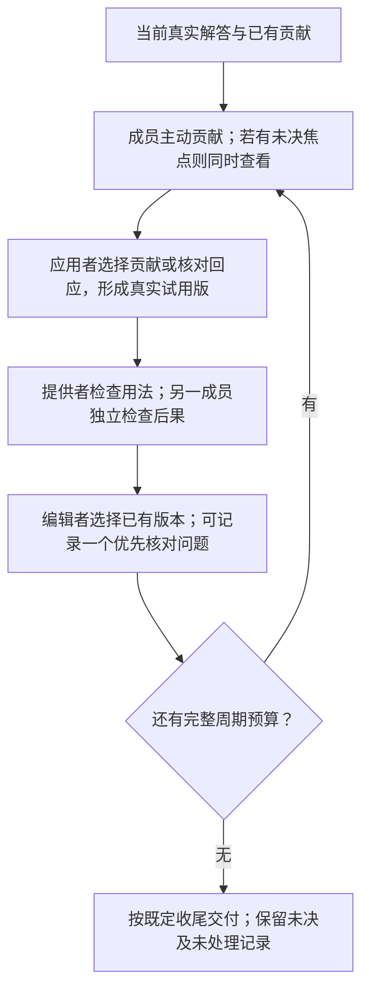

# 关键分歧进入下一次应用：机制设计D0

日期：2026-10-22。状态：可供实现审查的设计草案，未改运行代码，未启动解题实验。研究依据及边界见 [想法审核](../../../refine-logs/workboard-evaluation-20261022/DISAGREEMENT_IDEA_AUDIT_20261022.md)。D0是隔离机制的首个实现候选，不是已经冻结或验证的正式方法。

后续实现状态：本设计已落为独立 `coreta.workboard_d0` 原型，完成15项D0离线检查及相关旧版回归。实现决定、脚本化回放和两轮同家族审查见 [BUILD_NOTE](implement-stage/BUILD_NOTE.md)。原v3源码保持冻结；尚未进行新字段的真实模型输出兼容性或解题效果实验。上段为设计创建时的状态记录。

## 1. 主线与实质变化

目标：让成员在共同解答形成过程中发现自己知识的用途，通过实际应用及反馈，纠正知识与解题步骤之间的连接。

D0的具体假设：当贡献或检查引起关键争议时，将争议保存为一个具体可核对的问题，使相关成员在下一轮贡献中补充依据或检查结果，并让下一次实际应用使用这些内容，有望减少错误批评造成的信息丢失、促进真实修复。

旧实现已经要求检查对象、条件、操作、反例和后果；这些要求不能算本轮新增。新差异是跨轮的执行关系：**当前争议明确指定需要核对什么 → 下一轮贡献围绕它提供依据或结果 → 下一次实际应用显式处理该争议 → 后续检查看是否实际修订。**

不改变为新裁判、不增加专家信誉分数，也不把所有问题转成辩论。完整初答、主动贡献、实际TRY、提供者核对和其他成员检查仍是一般求解路径。没有显式分歧时仍正常推进，不把pass或共识视为正确。

## 2. 当前代码依据

运行规范仍为 workboard-v3：`src/coreta/workboard/runtime.py`、`prompts.py`、`contracts.py`、`artifacts.py`。

当前路径为 N次初答；每周期 N−1次OBSERVE、一次TRY、两次独立检查、一次CHOOSE；最后固定4次收尾。代码将检查与决定加入feedback，OBSERVE可看到历史feedback，但TRY不显式接收该争议的后续处理任务。CHOOSE只允许选旧稿或试用稿，不允许当场修复。

因此不能声称旧版“完全没有反馈返回”。实际缺口是后续成员可能看见历史，但没有聚焦的未决问题、针对性回应与实际修订之间的明确联系。

## 3. 一个周期怎样工作



核对通过现有OBSERVE与TRY完成，而非在每轮附加新调用。D0保留当前编辑者、贡献轮转、双检查和收尾，以便辨别这条跨轮联系的作用。后续角色、调度、去终检与压缩须另立变体，不混入D0归因。

## 4. 何时值得核对

成员可以在贡献或检查中指出具体冲突，编辑者在CHOOSE中选择一个优先焦点。冲突包括：双方读出的事实不同、同一条件被相反使用、同一操作声称产生不同后果，也包括某项关键主张与原句/实际结果冲突。无需等两个完整答案相反，更不要求所有成员都表达异议。

是否核对是可错的模型判断，程序不充当语义检测器。可操作的触发标准是：指出具体对象和位置；该争议会影响解答步骤、知识保留或最终选择；当前可见内容尚不足以让决策者说明它为何成立/不成立；存在可尝试的核对。若当前已有明确依据可直接处理，CHOOSE可以据此决定，下一轮不必重复核对。

编辑者也可能忽略正确异议。D0保留所有检查与贡献，下一轮成员仍可主动再次提出；记录其未聚焦状态，不能把未选中当成已解决。首版没有独立问题打分器，不声称语义优先级已解决。

核对焦点一次最多一个，用于限制输入和重复劳动；其他问题保留在原始反馈中，并可成为后续焦点。初版沿用原贡献轮转，相关回应可能得不到试用机会，此为已知限制而非隐式公平保证。

## 5. 用什么核对，由谁提供

优先焦点在下一轮向全体成员公开。材料持有人可以提供授权摘录，使用者可以说明具体用法，其他成员可以提出反例或指出测试无区分力；不按角色或资料归属授予正确性。

OBSERVE仍每人至多一项贡献或pass。可回应焦点，也可提出更重要的帮助；不强迫无知识的成员制造质疑。回应沿用现有offer的target、knowledge、support、proposed_use，并说明针对哪个焦点、所得依据/结果如何影响原判断。提供者无法完成核对时可以如实说明，不能把计划执行写成已执行。

可用核对包括已有原句及上下文对照、条件代入、算术重算、构造符合前提的反例，以及经宿主实际执行的操作。只有文本重述时，记录为提出的论证，不能自动升级成观察事实。两种解释预测相同结果时，该核对不能被说成区分了它们。

首个HiddenBench实现候选只支持任务内资料和文本推理核对，不新增联网、解释器或源文认证服务。公开原句仍是持有者的转述，除非未来引入同资源的宿主核验；D0不得给转述自动贴verified标签。模型只能读取本人原件、公开贡献和实际作品，不能读取离线答案。未来有宿主工具时，两条件同权限同预算。

不要求双方事先同意测试才允许继续。提出者应说明什么结果会支持/削弱具体主张；其他成员可以质疑检查的适用性。不能规定“测试未反驳即为真”，也不把一个有效反例当成完整修复。

## 6. 核对结果怎样改变解答

TRY明确接收焦点、相关历史检查、选中贡献及其公开支持。应用者可以生成新版本、复用实际存在的版本或说明unable。

使用记录以短文本说明：回应的争议是什么；可用依据/观察是什么；据此保留、撤销或修改了哪个实际步骤；下游哪些部分受影响。无需给整题预建依赖图。新版本必须物化，不能只写“已修复”。

处理原则：

- 批评有依据：修订受影响步骤；其余有独立支持的贡献仍可保留。
- 批评无依据：可以保留相应有效修改，并明确为何不接受该批评。
- 新资料改变条件：重审依赖该条件的结论，不自动否定原关系本身。
- 证据仍不足或检查无区分力：保留未决，不能通过投票或重复确认宣告核对完成。

检查者核对实际前后产物及结果的用法；可以指出核对设计错、引用失真或错误解释结果。CHOOSE仍选现有版本，因此每个实际修复均先经过原有检查再选择，避免最后一步产生未经检查的新答案。

程序检查ID、可见性与产物存在，不判断上述语义结论真伪。任何“已处理”是模型报告，不是正确性认证；离线评价另看实际内容。

## 7. 最小记录与状态

首版只增一个可空焦点对象，CHOOSE输出概念如下，现有candidate_id和reason仍保留：

```json
{
  "candidate_id": "W_existing",
  "reason": "选择该已有版本的具体依据",
  "next_check": {
    "target": "W_id及具体步骤或whole_goal",
    "question": "当前需要核对的局部命题",
    "check": "可尝试的原句核对、计算或反例；什么结果影响判断",
    "refs": ["当前可见的O或W等依据"]
  }
}
```

`next_check=null`合法，不强迫产生问题。程序分配焦点ID和产生它的作品/周期，记录后续关联O/W，模型不自行管理编号。上述为设计接口草图，不是已实现schema；字段枚举由实际可见对象派生，不固定最多几条原始资料。

回应在现有offer增加可空`responds_to`焦点ID；TRY沿用use_record说明实际使用。下一次CHOOSE对输入焦点增加一个轻量处置：`addressed`（报告已回应）、`pending`或`deferred`，附理由；程序不将addressed转换为verified。新的焦点和已有焦点可不同，旧问题仍保留处置及引用。

状态生命周期：`pending → addressed / pending / deferred`。收到回应、发现格式合法或选了试用版，均不自动变为addressed。被报告addressed后出现新的反证，成员仍可重新提出关联焦点。

焦点绑定产生它的作品及位置；作品更新后，成员先说明它是否仍适用于当前版本。已删除的步骤不继续被当成当前缺陷，但其知识仍可用于其他位置。程序只保存版本关联，不自动推断争议已失效。

TRY返回unable时沿用原路径，焦点保持pending，具体障碍进入下一轮反馈；没有后续周期时记deferred。全员pass也不关闭未决问题。相同问题换词重提不视为核对进展，能否识别语义重复仍是模型判断，原日志保留供离线审核。

当前所有批评原文与未选中贡献继续保留；焦点只是有限求解预算中的优先事项。没有自动生成全局争议图谱或独立裁判分数。

## 8. 停止、预算及完整性

首个隔离验证沿用v3完整周期数、贡献轮转、各阶段上限与固定收尾。最后一轮可以记录焦点，但没有后续周期时不得额外增加调用。既有FINALIZE读取所有未决问题、回应及真实作品，仍按原四调用收尾；收尾没有完成核对的，不标为已查清。

请求数不因D0固定增加：N次初答 + (N−1)×(N+3)次周期调用 + 4次收尾，即N=3时19、N=4时29（含初答）。新增焦点输入可能增加token，不能称同实际成本。诊断和对照需匹配调用与输出预算，报告实际输入、输出及延迟。

周期预算不足、全员pass或达到上限时依原规则停止。交付依任务接口作尽力选择，未决仍列明；旧稿、共识稿或有更多引用的稿都没有自动正确优先权。

技术异常与能力失败分开；不无限重试，不为每个失败另加补丁。改工具权限、调度或周期数时另版冻结。

## 9. 最小实现改动位置

| 位置 | 所需变化 | 不应混入的变化 |
|---|---|---|
|contracts.py|CHOOSE可空焦点与输入焦点处置；OBSERVE可空responds_to；合法引用动态派生|知识真值判定、宽松接受任意JSON|
|runtime.py|保存焦点和关联轨迹；OBSERVE/TRY/checks/CHOOSE均看到本周期相关焦点；保留未决至收尾|换编辑者、换轮转器、改变调用数|
|prompts.py|解释局部核对、结果与推断区别，以及实际修订要求|每轮强制全员争辩、强制达成共识|
|provenance.py/输入包装|焦点是公开转述及导航；不增加对他人原件的直接读取权|将未核验摘录认证为事实|
|离线分析|记录焦点→回应→实际修改→检查→选择，并核查真实语义|凭状态字段直接算机制成功|

实现前应再审字段是否能合并；本设计不直接修改冻结v3。

## 10. 可证伪的机制判断

设计预期在错误批评、条件误用和正确局部知识未保留时改善核对与修订；对无可用知识、全体共同误判而未察觉、无法构造有效核对的情形不作成功承诺。

同资源常规复核同样允许查依据、提出反例和实际修复。若D0只多写焦点字段，实际核对及修订不改善，或输入开销/错误干预抵消收益，应缩减或放弃这一实现。不能通过削弱基线、增加核对机会或事后挑成功题维持主张。
