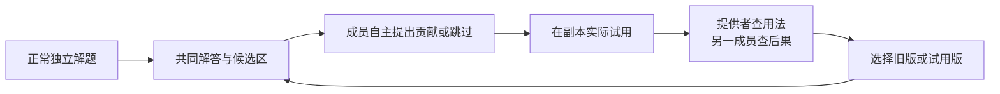

# CoReTA 新候选设计：围绕共同解答利用成员知识

2026-10-22。两轮独立上下文设计审查后形成；后续已写入独立最小实现，已完成离线工程检查和固定schema复制兼容，尚未进行能力实验。审查是同模型家族的暂定判断。实现选择与交付状态见[实现记录](implement-stage/BUILD_NOTE.md)。

## 核心问题

怎样让多Agent团队更好地利用成员专长，使不同成员的知识共同提高解题能力。

## 三个组件

| 组件 | 做什么 | 需要验证的作用 |
|---|---|---|
| 共同解答板 | 保留完整初稿、当前真实解答与版本 | 是否让知识持有者更容易发现自己能帮在哪里 |
| 主动贡献入口 | 未被提问也能指向某一步、提交依据/反例，或引用完整候选；可跳过 | 是否减少依赖编辑者先识别需求 |
| 试用与反馈 | 在副本应用，展示真实改动；提供者查用法，另一成员重建相关后果；选择现成版本 | 是否让正确知识真正改变解答，并发现误用 |

借鉴黑板的自选响应与同轮独立提交；中间解答增加具体贡献线索；check-back借鉴落实为“回看实际使用”，不把确认理解当真值验证。详见正文来源与旧版差异。

三个组件不等于三个固定角色或三个领域专家。成员数可变；三人开发默认最多两周期，现有四人任务最多三周期，编辑者固定、提供者与另一检查者随贡献改变。正常完整解题和现成正确候选都可保留、采用。

## 文档

- [完整设计与三块验证轮廓](SPEC.md)
- [实现接口与状态分支](INTERFACE.md)
- [构造走读与失败边界](../../../refine-logs/proactive-workboard-20261022/WORKED_EXAMPLES.md)
- [设计审查记录](../../../refine-logs/proactive-workboard-20261022/REVIEW_SUMMARY.md)
- [后续实现交接](../../../refine-logs/proactive-workboard-20261022/IMPLEMENTATION_HANDOFF.md)

## 结论与下一阶段

设计可进入实现交接；创新贡献与效果仍待比较。重点排除：只是增加计算、只减少终稿改写错误、成员仍看不出机会、固定编辑者误用正确知识、同源检查者重复错误。

独立运行器和开发预算已写入。18项工作板检查、184项扩展回归、12项真实格式复制已通过，见[验证报告](implement-stage/VALIDATION_20261022.md)。下一阶段冻结小规模真实行为试跑，再准备普通讨论/请求式黑板公平对照和实验预算。当前没有可以直接启动的新实验批次。
