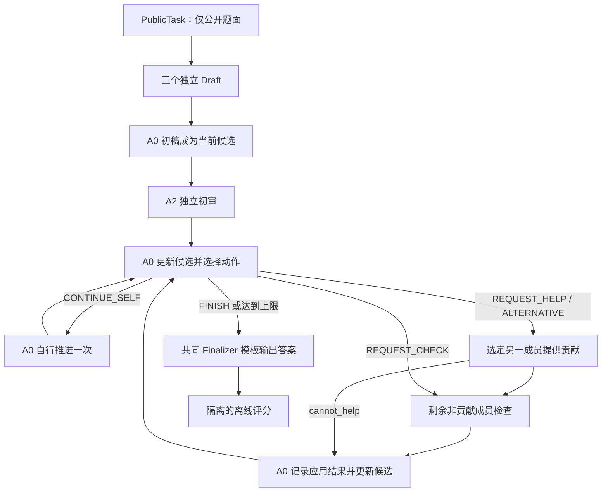

# CoReTA v0.3：可执行组件设计草案

日期：2026-10-18。状态：供实现与审查的设计，不含效果结论。版本从 v0.2 延续，保留三 Agent 和有限动作，明确消息、可见信息、实际整合及失败路径。来源对应 [SOURCE_LEDGER.md](SOURCE_LEDGER.md)。机器可读契约见 [coreta.schema.json](../design/v0.3/coreta.schema.json)，建议配置见 [run_config.proposed.json](../design/v0.3/run_config.proposed.json)。

## 研究锚点

> 提高多 Agent 团队的协调与问题解决能力，让成员已有知识及协作中新产生的有用贡献得到实际利用；先把定向帮助、贡献检查、整合与应用反馈落实为三 Agent 可执行协议，再用已有论文采用的任务检验整体能力与互补作用。优先借鉴公开方法和官方代码，清楚区分复用接口与本项目的机制假设。能力与机制优先，成本如实记录，同成本优势与节约成本后置。本轮交付设计，不运行付费模型、训练或真实效果实验。

## 1. 主假设与设计范围

根据可见解题进展提出有具体交付要求的帮助，再检查、整合并依据实际应用结果调整下一动作，可能比固定讨论更好地利用成员贡献。该假设涉及整个组织协议；总得分不能单独识别互补原因。

本轮固定三个独立上下文实例 A0/A1/A2。第一版 A0 负责维护候选与最终输出；A1/A2 均可提供补全、反例、修复、替代解或检查，按每次请求切换职责。三者先独立解题，角色名称不预先赋予真实专长。程序调度器不算第四名 Agent，也不判断答案真假。

第一版建议三者均用 Qwen3-32B 非思考模式，先控制底座差异；它不是最强模型宣称。当前研究对象包含同模型独立执行产生的贡献差异，不能据此宣称已利用异构模型专长。异构实验单列扩展。

v0.3 的第一批任务都是无运行时工具的文本推理/代码生成，内容检查由非贡献者 LLM 进行。客观数学评分、代码执行只在结束后由评价进程完成。后续加工具时，各方法同时开放；不能把参考答案或隐藏测试包装成在线检查器。

## 2. 借鉴关系及机制差额

| 内容 | 实现选择 | 来源性质 |
|---|---|---|
| 消息封装 | id、发送者、接收者、动作来源、结构化载荷 | 借鉴 MetaGPT S1 的字段命名，自写轻量适配 |
| 调度 | 主解题者提出动作，程序只检查合法性并分发 | 借鉴 AutoGen S2 的内容与控制分离 |
| 帮助 | 明确请求、成员允许无法帮助、接收者决定采用 | 借鉴 Blackboard S3；定向单收件者是本方案选择 |
| 独立起点 | 每人独立起草，保存上下文与初始答案 | 借鉴 Debate/MoA S4/S5 |
| 需求—贡献—应用—下一动作关联 | 请求绑定候选版本与步骤；应用记录明确变化并作为下次输入 | CoReTA 的机制假设和工程适配，不声称上述单个组件首创 |

比较过两个实现选项：完整引入 AutoGen/MetaGPT 与自写同步 Python 编排。选后者，因为三个成员及有限动作可以用共享接口表达，不需要多进程消息总线或框架的额外角色。状态与路由字段尽量沿用已核实现，避免自造一套复杂通信标准。

## 3. 系统图与运行状态

会话状态为 `task + roster + leader + current_version + current_candidate + drafts + events + applications + turns_used + runtime_status`。运行状态为 `INIT → BOOTSTRAP_CHECK → LEAD_UPDATE → WORK_TURN → FINALIZE → DONE`；任意步骤可记录 `DEGRADED` 或 `FAILED`。步骤状态只表达模型的判断，不是真值。

## 4. 组件一：共享状态与上下文构造

### 4.1 数据结构

完整结构由 JSON Schema 指定，下列为语义说明。

- `PublicTask`：task_id、task_type、prompt、可空 entry_point。白名单构造；不含 gold、solution、canonical_solution、test 或 hidden inputs。
- `Candidate`：artifact（数学候选答案或完整代码）、summary、最多八个公开推理支点 steps、最多三个 open_issues。Step 含 id、text、basis_refs、status。只要求简要可审查依据，不将记录解释成模型内部认知状态。
- `Event`：schema_version、run_id、task_id、sequence、event_id、kind、sent_from、单收件者 send_to、cause_by、parent_ids、base_version、created_at、payload。
- 事件类型：draft、request、contribution、review、lead_update、final、runtime_error。原始模型请求/响应、usage、latency 单独写入 trace，避免业务消息载荷混入服务端内部字段。

id、sequence、时间、发送身份、版本和关联关系由程序生成。模型只能产生载荷内容，不能通过自报改变权限或历史。steps 的 id 在每版内唯一，引用格式为 `v{version}:{step_id}`，例如 `v2:s3`；旧引用留在日志，当前请求引用当前版本。版本更新时由程序递增，完整旧候选保留，不做自动语义 diff 或整棵依赖图回滚。

### 4.2 信息可见范围

| 调用 | 输入 |
|---|---|
| 独立起草 | 公开任务、通用解题要求、输出结构；不读其他初稿 |
| 初审 | 公开任务、A0 初稿、A2 自己的初稿；不读 A1 的初稿 |
| 主解题者更新 | 任务、三个初稿、当前候选、相关贡献与检查、此前应用记录 |
| 帮助者 | 任务、自己的初稿、当前候选、完整定向请求；不读另一帮助者的私有初稿或原始会话 |
| 贡献检查者 | 任务、自己的初稿、请求、对应版本候选、贡献；不读主解题者随后是否采纳 |
| Finalizer | 任务、可见候选/消息包、共同输出提示；不读金标准或评分 |

数据在程序端共享，不等于每次向每人广播所有记录。成员的角色上下文分别维护。默认视图保留初稿、最新候选、贡献/检查和短应用记录，省略被后续版本替代的完整旧候选；历史原文仍存盘。

模型输入中的 DRAFTS/OWN_DRAFT/NEW_EVIDENCE 不是没有身份的裸载荷，而是 `{event_id, sent_from, base_version, payload}` 的只读包装；CURRENT 为 `{version, source_event_id, candidate}`。每个阶段都附本分支可见 REFERENCE_INDEX，初稿步骤引用采用 `event_id#step_id`，主候选步骤采用 `vN:step_id`。程序拒绝引用不存在、不可见或其他分支的事件。这些包装由上下文构造器加入，不让模型重写，输出 Schema 仍只约束对应载荷。

每次请求由上下文构造器显式重建，模型接口没有另一个自动累积的隐藏会话。原始 trace、历史 Decision 和已移除字段不得由 SDK 自动追加。用于模型的角色记忆只包括上表白名单视图；这也是 Generic-help 和 No-application-record 能成立的必要实现条件。

输入最大 24,576 tokens。超限时先整体移除最早已完成请求的消息包并记录被移除 id，始终保留题面、初稿、最新候选和最近请求包；仍超限则记录 CONTEXT_OVERFLOW，不隐式改写题目或用额外 LLM 摘要。各方法采用同一视图构造原则。

## 5. 组件二：定向帮助与动作选择

主解题者在每次更新中同时输出 Candidate 和 Decision。Decision 包含 action、recipient、request、reason。有限动作：

| 动作 | 前提与下一执行 |
|---|---|
| CONTINUE_SELF | recipient/request 均为 null；下一工作轮调用 A0 自行推进 |
| REQUEST_HELP | recipient 为 A1/A2；request.kind=complete；请求一个具体交付 |
| REQUEST_CHECK | recipient 为 A1/A2；request.kind=verify；调用该成员检查当前候选，然后 A0 更新 |
| REQUEST_ALTERNATIVE | recipient 为 A1/A2；request.kind=alternative；允许完整替代解，经另一成员检查后 A0 更新 |
| FINISH | recipient/request 均为 null；进入统一 Finalizer |

HelpRequest 字段：kind、goal、target_step_ids、current_attempt、deliverable、check_plan、reason_for_recipient。check_plan 描述用题面约束、可见计算或反例能检查什么，不能要求查金标准。

选人策略是 A0 的可执行提示策略：先比较两人的初稿及当前请求，引用与所需交付相关的可见支点；没有充分依据时允许明确表示缺乏线索，用预定轮换选一人尝试，或改为自行推进/替代解。该判断可能失误，列为被测行为，不新增免费能力预测器或事后 oracle。

请求可以指向全局方向：REQUEST_ALTERNATIVE 的 target_step_ids 可为空；普通 complete/verify 应引用至少一个当前步骤。如果当前无法定位问题，允许检查整体方案，不强迫虚构局部缺口。此时 verify 目标写 `whole_candidate`，target_step_ids 为空，并在 goal 中明确范围。

程序校验：角色、动作与 kind 一致、引用存在、base_version 未过期、工作轮剩余。重复请求只记日志，不依赖模型自报 unresolved 阻止下一调用；主解题者提示仍要求避免无进展重复。各条件统一受两个工作轮限制，不引入会随 Application 消融而变化的隐含调度规则。语义上是否真的有新问题由模型负责，程序不假装识别自然语言净收益。

### 5.1 一次 LeadUpdate 的版本与引用事务

调用输入显式包含 `current_version=n` 和 `REFERENCE_INDEX`（本分支可见事件 id、旧版本步骤与当前步骤 id 清单）。输出先作为待提交事务解析：Application.before_refs 只能指向输入中已存在的版本和事件；changed_step_ids 必须存在于输出新 Candidate；Decision.request.target_step_ids 针对输出新 Candidate，而非输入旧 Candidate。Candidate 的 id/version 不让模型自行赋值。

事务全部合法后，程序提交新 Candidate 为 n+1，随后根据 Decision 创建 request 事件，其 base_version=n+1。LeadUpdate 事件本身的 base_version=n。全局替代或整体验证可用空目标列表；普通请求目标需引用提交后的有效步骤。若 schema/引用校验失败，不提交半个候选或先发出请求，按统一结构修复规则处理。最后工作轮完成时，合法动作只剩 FINISH。

Generic-help 变体使用同一 HelpRequest 结构，但实际发送的字段为：kind 保持原 complete/alternative，goal 为通用审查要求，target_step_ids=[]，current_attempt 为“See the current candidate”，deliverable 为通用修正/补全/替代，check_plan 为“Check against the public task”，reason_for_recipient 为“Scheduled peer for this interaction”。该 whole-candidate 空目标是此变体的显式例外，程序知道方法配置；不得从原请求保留具体线索。纯 REQUEST_CHECK 不是 B2 的定向帮助干预位置，照常保留并单报其频次。

## 6. 组件三：贡献检查与实际整合

贡献返回 request_id、status、body、basis_refs、check_suggestion。status 可为 provided 或 cannot_help。允许局部引理、反例、计算、补丁和替代方向；不强迫为错误前提补洞。cannot_help 直接进入 A0 更新，不浪费一次空贡献检查。

贡献者为 A1 时由 A2 检查，反之亦然。Review 给出 subject_id、supported/defect/unresolved、最多三个 findings、scope_limit。finding 要定位主张，说明理由和可见依据。supported 只表示该检查者在所列范围的支持，不记作证明正确。自报置信度和人数不作为裁决分数。

A0 接收贡献与检查后输出完整新候选及 Application：request_id、contribution_id、review_id、accepted/rejected/deferred、before_refs、changed_step_ids、resolved/unresolved/regressed/unknown、reason。纯检查时 contribution_id 可空；初审时 request_id 可空。

采纳补全需说明新增内容接入何处；拒绝需引用具体理由；检查者支持也允许主解题者指出缺陷，检查者反对也允许主解题者给出依据后采纳。争议不能由程序强行判真。对已有支持的步骤进行替换，要求给出具体异议或新依据；未完成部分可直接补充。

若只确认旧步骤而无内容更新，允许 accepted 且 changed_step_ids 为空，记录“仅增加支持”；这不算新增推理内容。Application 的 resolved 等是自报运行信号，必须与最终评分和后续分析分开。

## 7. 组件四：应用反馈、独立检查与停止

每次 A0 更新时，先填写实际应用和剩余问题，再选择 next。其下一输入保留此前应用记录：已解决则继续推进或结束，未解决可换成员、请求替代或自行思考，出现反证则撤回相应候选内容。程序只强制提供记录和遵守合法动作，不保证“标为 resolved”是真解决。

为覆盖自信错误，A0 第一次决策前固定由 A2 审查 A0 初稿，不以自报困难触发，且不得使用测试正确性决定是否检查。此步骤也是整体协议的一部分；机制对照需要区分收益是否仅来自这次额外审查。

默认最多两个工作轮，每轮为一次自行推进、一次检查，或一项帮助/替代及其检查与应用。初稿与初审不占工作轮。两轮是工程默认值，非经验最优；后续只在开发数据上调整。无正当依据的重复帮助、cannot_help、未决都可结束，不强制每题协作。

完整路径调用上界：三个初稿 + 一次初审 + 一次 A0 更新/决策 + 两轮各三次调用（帮助、检查、应用并决策）+ 一次统一 Finalizer = 12 次正常模型调用。自行推进轮用一次；纯检查轮用两次；cannot_help 轮用两次。FINISH 没有额外控制模型调用。

格式/引用错误每个输出至多修复一次，整题至多两次；仅返回结构错误，不提供正确答案或内容修正。故最多 14 次生成请求。网络错误每请求至多重试两次，HTTP 尝试上界 42；所有可能已计费但未收到结果的尝试保留 uncertain usage。超时或不可修复输出记录错误，停止协作，用最后合法候选进入预留 Finalizer；Finalizer 失败时返回该候选 artifact 并标记 degraded。没有合法候选则输出空答案并记失败。不能静默替换成另一个 Agent 的答案。

## 8. 统一输出与评分隔离

所有需汇总的条件用同一 Finalizer 模板、底座和生成设置，允许它继续推理及产生新解；输入消息包随处理不同而不同。只读初稿的汇总器不能被禁止修复，这样的修复属于该对照能力。

Finalizer 的默认消息包按以下白名单构造，成员顺序固定 A0/A1/A2，消息顺序按事件序号，输入不包含方法名称：

| 条件 | 允许的证据包 |
|---|---|
| Single-finalized | A0 初稿 |
| Solo-refine | A0 初稿与两轮后最新 Candidate，去重；不含其他成员 |
| Independent-aggregate | 三个初稿 |
| Static-debate | 三个初稿及最后交流轮三个更新候选；不含第一更新轮的完整候选 |
| CoReTA | 三个初稿、最新 Candidate、初审 Review、实际发送的请求/贡献/检查及 Application；不含历史完整旧 Candidate 或原始 Decision |
| Generic-help | 同 CoReTA，但只含实际发送的通用请求及后续结果，原始定向字段不可见 |
| No-application-record | 同 CoReTA，但 Application 在所有后续视图与最终证据包中均不可见 |

共同上下文上限仍适用。方法间因交互产生的信息差异是处理的一部分，不为强求相同输入而抹平；Finalizer 前的当前候选定义为该条件 A0 最新候选，Independent/Single 则为 A0 初稿。

数学最终 artifact 要含一个明确的最终 boxed 答案；代码最终 artifact 为可执行完整函数源码。另保存 basis_refs，但引用不能独立证明贡献起因。最终输出若改变了 A0 候选，保留两者并单独统计 finalizer 改变与收益。

数据入口分别构造 PublicTask 和 EvaluationRecord。后者只在离线评分器进程读取，结果写入 scores，与运行 trace 分目录。运行时不读取离线评分结果；状态管理也不允许通过 task_id 查询参考解。

## 9. 提示词、接口与实现拆分

完整提示词见 [PROMPTS.md](../design/v0.3/PROMPTS.md)，载荷与字段限制见 Schema。建议实现文件：

| 文件 | 职责 |
|---|---|
| schemas.py | 按契约定义 Pydantic 类与结构/引用校验 |
| model_client.py | 共享模型请求、生成配置、结构修复、usage 与 timeout |
| state.py | 追加事件、版本候选、确定性上下文视图 |
| protocol.py | 三初稿、初审、有限动作、贡献检查、应用和停止 |
| prompts.py | 载入固定模板与按任务输出格式适配 |
| tasks/math.py、tasks/code.py | 白名单题面适配与独立评分入口 |
| baselines.py | 单体、独立汇总、静态讨论及机制变体 |
| run.py、analyze.py | 任务/运行清单、结果恢复、配对分析 |

共享模型调用封装；成员只是配置和各自上下文，不写三套服务。预计核心协议数百行、含解析日志的运行骨架千行量级，仅为工程估计。新增字段和模板也需纳入版本控制。

## 10. 核心验证与剩余依赖

三块验证：整体能力（数学/代码、独立汇总及静态讨论等）；机制组织（普通帮助与显式应用记录变体）；具体内容依赖（预定首个帮助位置的真实/冗余贡献分支）。细节由 EXPERIMENT_PLAN 给出，不能用第一块的提升替代后两块。

本设计不预设新颖性、协调正确性或任务增益。服务端地址、模型/tokenizer 实际 revision、EvalPlus 软件版本、数据哈希和实际硬件需在实施前填入运行清单；它们是部署依赖，不改变本轮明确的协议规则。成本不作为当前必须改善的目标。
