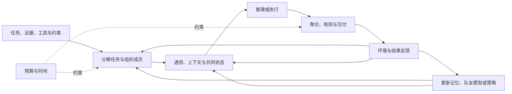

# LLM 多 Agent 研究总览：从组织与通信到聚合、学习和可靠执行

检索截止：2026-10-18（Asia/Shanghai）。用途：建立方法研究地图，供阅读与后续构思使用。未启动实验，不作任何具体方案的创新性认证。

后续方法审查见 [RESEARCH_REVIEW_20261018.md](C:/Users/QVQ/Documents/ChatGPT/agent-research/RESEARCH_REVIEW_20261018.md)：补入DoVer、VeriMAP、MARCH、风险校准与provenance近邻，修订错误信息实验的样本选择口径，并提出候选方法草图。本文仍为方向地图，不代表具体方法近邻已穷尽。

## 摘要

多 Agent 既指多个实例共同解一道题，也包括有不同工具、资料和状态的成员分工执行长任务。两者共享通信与决策问题，但其任务产物、成功条件和有效对照不同。本轮按组织与工作流、通信与知识、推理与聚合、学习与适应、可靠性与评测检索，并将代表方法与负面证据对照。已有研究已超过固定角色提示阶段：工作流可自动搜索，路由和协调可被训练，任务状态可在运行中更新，成员可根据队友反馈和经验调整配合；共同推理也已研究选择性交互、置信度使用、互补候选和预算停止。与此同时，更复杂组织不保证更好结果，一致意见不保证正确，过程核验也可能失败。跨任务、跨成员的可迁移协作能力、无真值条件下的可靠贡献利用，以及开放产物的交接与恢复仍需具体方法和严谨比较。本报告将“已有机制”“证据适用范围”和“进一步研究的问题”分开，不把某一论文的局限直接宣布为空白。

## 1. 要回答的问题与范围

- **RQ1：**现在研究哪些不同的协作问题，架构、通信、聚合、学习怎样区分？
- **RQ2：**代表论文具体改变了什么，近期方法已经实现到什么程度？
- **RQ3：**哪些结论有条件，哪些能力仍不稳定，评价怎样影响结论？

本报告以完成任务的 LLM 多 Agent 为中心，涵盖分工执行、同题推理及其混合。谈判、竞争和社会模拟作为重要邻域单独说明；不声称覆盖传统 MAS/MARL 的全部算法、具身控制或全部人机协同研究。LLM 多 Agent 也不必使用多个不同模型：同一底模可以建立多个有独立上下文、工具、角色和记忆的实例。不同实例不自动拥有真实互补专长。

## 2. 检索和证据使用方式

三路文献任务分别调查组织/通信、推理/聚合、学习/可靠性；主执行者补综述、评测、成本、动态环境与利益博弈。先做主流机制搜索，再按论文名、反证、同义机制和近期进展补查；保留每路查询记录及访问层级。信息收集的并行视角不构成独立评审。

最终采用原始 arXiv、ACL Anthology、PMLR、ICLR/NeurIPS 论文集及作者机构记录。二手页面只用于发现，不承担论文结论。会议官方记录优先；仅作者声明录用时明确标识，未确认者按预印本；不把2026年10月新稿当成已复核领域定论。版本修订可能改变标题、结果和样本，不混用。

细节与检索记录见 [组织与通信](C:/Users/QVQ/Documents/ChatGPT/agent-research/research/multiagent-landscape-20261018/ARCHITECTURE_COMMUNICATION.md)、[共同推理与聚合](C:/Users/QVQ/Documents/ChatGPT/agent-research/research/multiagent-landscape-20261018/AGGREGATION_REASONING.md)、[学习与可靠性](C:/Users/QVQ/Documents/ChatGPT/agent-research/research/multiagent-landscape-20261018/LEARNING_RELIABILITY.md)、[评测与范围](C:/Users/QVQ/Documents/ChatGPT/agent-research/research/multiagent-landscape-20261018/EVALUATION_AND_SCOPE.md)。证据分册区分原始摘要核验、正文相关段落阅读与复现；本轮没有代码复现。总览所称“做到”指论文在其任务与模型下实现或报告，不代表开放环境普遍解决。没有全库去重与穷尽性证明，不计算论文类别占比或全局SOTA排行榜。

作为阅读索引，Tran 等的 [Multi-Agent Collaboration Mechanisms](https://arxiv.org/abs/2501.06322) 区分参与者、目标关系、结构、策略和协议；Yan 等的 [Beyond Self-Talk](https://journal.hep.com.cn/fcs/EN/10.1007/s11704-026-50857-y) 强调通信对象和内容；Li 等的 [Beyond More Agents](https://research.aston.ac.uk/en/publications/beyond-more-agents-a-survey-of-collaboration-mechanisms-in-multi-/) 将协调、通信、协商、记忆和学习联系起来，后者为工作论文。三者用来检查分类遗漏，具体机制仍回原始方法核对。

## 3. 先区分任务形态，再区分控制对象

### 3.1 三种任务形态

| 形态 | 实际工作方式 | 团队需要怎样整合 | 典型成功条件 |
|---|---|---|---|
| 同题共同推理 | 多个成员回答同一题，之后交流或聚合 | 在候选中选择、核验或形成更好答案 | 最终正确性、回答质量与推理成本 |
| 分工执行 | 不同成员检索、分析、编程、测试或执行不同动作 | 接口可用、依赖满足、状态一致、产物兼容 | 完整交付、约束、安全、成本和时间 |
| 混合 | 平时分工，难点联合推理或核验 | 既处理产物依赖，也控制局部讨论 | 两种能力及其切换成本 |

给三个实例贴不同专家标签，却让它们完整回答同一题，仍接近共同推理。反之，执行团队中的“讨论”可能是在澄清接口和交接，不是辩论答案。不能用是否出现聊天来区分任务类型。

### 3.2 研究地图

| 控制对象 | 主要问题 | 常见方法 |
|---|---|---|
| 成员、角色与任务边界 | 谁参与、负责什么、任务怎么拆 | 专家招募、角色分工、能力路由、任务互依设计 |
| 工作流与控制权 | 谁先行动、谁看谁、谁能调整分工 | SOP、图搜索、层级/分布式控制、动态任务图、学习控制器 |
| 通信、上下文与知识 | 什么信息在何时传给谁、保存多久 | 边裁剪、消息选择/压缩、共享板、团队记忆、主动澄清 |
| 判断与聚合 | 多个答案、证据或产物怎样成为结果 | 投票、排序、融合、辩论、置信度加权、验证读出 |
| 学习和伙伴适应 | 如何改进配合、怎样给成员分配贡献 | 队友建模、经验更新、协作RL、角色奖励、反事实信用 |
| 可靠交付与资源 | 如何发现/恢复错误、应否继续讨论 | 核验、局部恢复、鲁棒通信、预算路由、停止规则 |
| 评测与机制解释 | 收益来自互动还是额外资源 | 同预算基线、信息条件控制、轨迹诊断、动态环境与干预 |

这七项是不同控制对象，不是互斥的论文箱子。一个系统可同时改变多个对象，比较时要分别记录。尤其区分三类图：Agent通信图、子任务依赖图、模型调用计算图；增加任务边不等于改变通信拓扑。

图表示研究控制环，不意味着每篇论文具备所有模块，也不表示必须搭建全功能系统。

## 4. 组织与工作流：不只是给模型分配人设

MetaGPT 用 SOP 和文档工件约束交接，ChatDev 更强调原子角色对话，两者都把任务结构写进系统；AutoGen 则提供可配置会话和工具基础设施，不能把整个 AutoGen 等同于某个固定星形算法。AgentVerse 会根据目标和评价调整专家配置，说明“现有框架只有固定角色”早已不准确。

| 代表论文及状态 | 解决的问题 | 关键机制与边界 |
|---|---|---|
| [MetaGPT](https://proceedings.iclr.cc/paper_files/paper/2024/hash/6507b115562bb0a305f1958ccc87355a-Abstract-Conference.html), ICLR2024 | 软件职能产物衔接 | SOP、结构化工件、角色订阅与执行反馈；不能直接外推为跨域最优组织 |
| [ChatDev](https://aclanthology.org/2024.acl-long.810/), ACL2024 | 软件开发对话和澄清 | chat chain组织设计/编码/测试的角色对话；不是无结构自由聊天 |
| [AutoGen](https://arxiv.org/abs/2308.08155), COLM2024 | 可复用的人、LLM、工具协作 | 可编程会话与自动回复；是框架平台，具体配置才是实验方法 |
| [AgentVerse](https://proceedings.iclr.cc/paper_files/paper/2024/hash/578e65cdee35d00c708d4c64bce32971-Abstract-Conference.html), ICLR2024 | 不同任务需要不同专家 | 招募→共同决策→行动→评价循环；提示专业身份不等于真实能力 |
| [GPTSwarm](https://proceedings.mlr.press/v235/zhuge24a.html), ICML2024 | 自动优化Agent调用组合 | 优化操作DAG的节点提示和跨图边；计算节点不全是自治成员 |
| [AFlow](https://proceedings.iclr.cc/paper_files/paper/2025/hash/5492ecbce4439401798dcd2c90be94cd-Abstract-Conference.html), ICLR2025 | 免人工试凑工作流 | 用代码表示工作流、搜索并运行评分；搜索期成本与测试执行成本分开 |
| [MaAS](https://proceedings.mlr.press/v267/zhang25bi.html), ICML2025 | 不同题分配不同复杂度的系统 | 学习按query选择operator子网络；不等于每步根据环境反馈重构 |
| [Conductor](https://arxiv.org/abs/2512.04388v5), ICLR2026 | 联合选择子任务、模型和消息可见性 | RL训练编排模型生成任务、worker和access list；基础版先生成完整流程 |
| [DyLAN](https://arxiv.org/abs/2310.02170v2), COLM2024 | 按贡献选队、减少低效成员 | 试运行贡献评分、成员去激活与提前停止；试运行也有成本 |
| [LATTE](https://arxiv.org/html/2605.06320v1), 2026预印本 | 运行中发现任务、维护依赖和责任 | worker提议，lead合并任务DAG及认领/释放/验证；不是纯去中心化 |
| [NeuralFSM](https://aclanthology.org/2026.acl-long.1543/), ACL2026 | 学习下一步状态和通信路由 | 从轨迹学习状态转移和通信权重；受训练分布与状态表示约束 |
| [ORCH](https://arxiv.org/html/2609.11737v2), 2026预印本 | 按任务互依构造层级 | 水平并行与垂直阶段组织可组合；层级构造后固定，计划和分派可变 |

AFlow 在验证任务上搜索可复用程序，MaAS 学逐题结构分布，Conductor 学语言编排策略，NeuralFSM 调执行中的状态与路由；四者虽都称自适应，改变的时机和对象不同。LATTE 另将任务依赖本身作为可更新状态，不能仅看“有图”就归为同一方法。

**当前程度：**已有自动设计、训练式编排、按题资源配置和运行时任务管理，不能再把“动态组织”单独当新意。尚未稳定解决的是跨任务/模型组合迁移、改结构的可靠依据，以及组织收益是否抵得过发现和控制开销。ORCH 的50成员具身设置、LATTE的5人构造任务和问答工作流不应放进一张绝对分数榜。

## 5. 通信与知识：谁能说、说什么、怎样保存、通过什么介质说

AgentPrune 优化消息通路，PACT 在给定组织下改变消息内容，G-Memory 管理跨任务经验；三者分别减少不同冗余，不能用“压缩通信”统一掩盖。Conductor 的 access list 和 LATTE 的局部上下文进一步说明，信息可见性同时参与分工与组织控制。

| 代表论文及状态 | 方法控制什么 | 实际机制与限制 |
|---|---|---|
| [AgentPrune: Cut the Crap](https://proceedings.iclr.cc/paper_files/paper/2025/hash/bbc461518c59a2a8d64e70e2c38c4a0e-Abstract-Conference.html), ICLR2025 | 消息图通路 | 学习剪去空间/时间冗余边；不是自动生成语义摘要 |
| [AgentDropout](https://aclanthology.org/2025.acl-long.1170/), ACL2025 | 成员/轮次参与 | 优化节点和边的dropout，减少冗余成员调用；不能只据dynamic名称认定内容触发 |
| [PACT: What Should Agents Say?](https://arxiv.org/html/2606.05304v1), 2026预印本 | 交接消息内容 | 将输出组织为action/state/result，比较全文、摘要、结论和工件等；没有一种短消息策略处处最优 |
| [CoThinker](https://arxiv.org/abs/2506.06843v3), 2026v3预印本 | 专业化、共同知识和通信 | TMS与moderator管理贡献与共同状态；低负荷任务可能付出更多协调成本 |
| [G-Memory](https://proceedings.neurips.cc/paper_files/paper/2025/hash/136a45cd9b841bf785625709a19c6508-Abstract-Conference.html), NeurIPS2025 | 跨任务协作经验 | interaction/query/insight三层图及角色相关检索；经验生成和检索也有成本 |
| [MATM](https://arxiv.org/abs/2606.19911v2), 2026-10-15v2预印本 | 跨Agent群体的轨迹复用 | 生产者入库、消费者检索续轨；有学习排序器，不是全系统免训练 |
| [LLMA-Mem](https://arxiv.org/abs/2604.03295v1), 2026预印本 | 私有/共享记忆与团队规模 | 比较不同记忆拓扑；其受控消融中私有经验更好，不支持共享越多越好 |

更底层的路线已经越过自然语言：

| 代表论文及状态 | 方法 | 使用条件 |
|---|---|---|
| [Cache-to-Cache](https://proceedings.iclr.cc/paper_files/paper/2026/hash/474ada926b331d78f06d95e8913111cc-Abstract-Conference.html), ICLR2026 | 学习投影和融合不同模型的KV-cache | 需访问内部状态及训练映射；不是普通黑箱文本API方案 |
| [Interlat: Enabling Agents to Communicate Entirely in Latent Space](https://aclanthology.org/2026.acl-long.1248/), ACL2026 | hidden-state通信与学习式压缩 | 作者定位为可行性研究，异构兼容和审计仍有约束 |
| [LatentMAS](https://arxiv.org/abs/2511.20639v4), 作者声明ICML2026 | latent生成与共享latent working memory | 与文本消息不同，依赖内部表示访问；减少输出token不是全部计算为零 |

这三项以原始摘要/状态核验支撑路线概述，见 [补查记录](C:/Users/QVQ/Documents/ChatGPT/agent-research/research/multiagent-landscape-20261018/LATENT_COMMUNICATION_SUPPLEMENT.md)，本轮不采信未经全文核验的极值加速倍数为普遍效果。文本接口下容易实现的框架，与内部表示方法是不同资源条件，不能要求同一API平台直接复现所有论文。

**当前程度：**通路稀疏化、角色相关上下文、跨任务经验和潜在通信都有方法。难点不是“加共享记忆”，而是在压缩和隔离后仍保留关键证据、撤销过时知识、控制污染，并让新增信息被正确使用。MATM 的开放群体检索也不等于同一团队面对面协商。

## 6. 同题推理与聚合：采样、交互和读出要拆开看

Self-Consistency 与 Agent Forest 不靠同伴交互即可获益，因此是共同推理的重要强基线；Du 等的 MAD 则让成员读同伴推理后改答案。ReConcile 同时引入跨模型差异、讨论提示和置信度加权；LLM-Blender 学排序和生成融合；MoA 用层状生成器吸收上一层答案。它们并不是一类“多数投票”。

| 代表论文及状态 | 信息如何合并 | 关键边界 |
|---|---|---|
| [Self-Consistency](https://arxiv.org/abs/2203.11171v4), ICLR2023 | 多条独立推理路径的答案一致性 | 无成员交互；相同系统错误不会自动消失 |
| [More Agents Is All You Need](https://arxiv.org/abs/2402.05120v2), TMLR2024 | Agent Forest采样与投票 | 人数收益与采样预算相关，不是无限加人规律 |
| [Multiagent Debate](https://proceedings.mlr.press/v235/du24e.html), ICML2024 | 独立答→阅读同伴→多轮修订 | 比单次答更好不等于比同预算采样更好 |
| [LLM-Blender](https://arxiv.org/abs/2306.02561v3), ACL2023 | 训练PairRanker与GenFuser排序/融合 | 排序与融合有训练成本，评审偏好不等于事实真值 |
| [ReConcile](https://aclanthology.org/2024.acl-long.381/), ACL2024 | 异质模型交流、置信度加权 | 自报置信度需校准；不能将全部收益归辩论 |
| [Mixture-of-Agents](https://proceedings.iclr.cc/paper_files/paper/2025/hash/5434be94e82c54327bb9dcaf7fca52b6-Abstract-Conference.html), ICLR2025 | 后一层生成器综合前层多个回答 | 主要开放回答质量证据；不是参数级MoE |
| [Voting or Consensus?](https://aclanthology.org/2025.findings-acl.606/), Findings ACL2025 | 控制讨论条件比较决策协议 | 不同任务更适合不同决策，更多轮数可能损害结果 |
| [Debate or Vote](https://proceedings.neurips.cc/paper_files/paper/2025/hash/934252acd87f254d5d4672fbde283bd2-Abstract-Conference.html), NeurIPS2025 | 分离初始采样投票和交互贡献 | 所测主要增益来自投票；理论有假设，不是普遍辩论无效定理 |
| [LASE](https://proceedings.mlr.press/v306/yoa26a.html), ICML2026 | leader–supporter非对称、选择性展开讨论 | 正面效率证据，但不证明任意场景都要中心leader |
| [Demystifying Multi-Agent Debate](https://aclanthology.org/2026.findings-acl.1694/), Findings ACL2026 | 多样候选初始化、训练置信度表达和使用 | 只有初始化无需训练，置信度分支用GRPO+LoRA |
| [When Debate Helps](https://arxiv.org/abs/2610.04686v1), 2026-10-03预印本 | 区分互补提案供给与验证感知读出 | 新近机制证据，尚不是跨模型、开放产物的普遍解释 |

早期 MAD 的正面实验与后续投票反证不必矛盾：基线、模型和预算不一致时，“讨论比单次答好”可以与“讨论不比同预算采样好”同时成立。LASE 与训练式方法又表明，选择性交互可能重新产生收益。更合理的检验是同时统计错误答案被纠正、正确答案被破坏，以及初始候选没有正确答案时是否生成新解。

[Multi-Agent Teams Hold Experts Back](https://arxiv.org/html/2602.01011v4) 把专家利用问题推进一步，但要按任务读表：心理任务观察到专家知识被稀释；ML表2的6.3–41.1%差距相对逐题ALOC理想上界，不是相对固定最佳模型的普遍降幅。部分团队已超过固定最佳单模型。未回收全部候选潜力、输给固定专家、超过平均成员是三种不同结论。

**当前程度：**已研究候选覆盖、相关错误、少数正确意见、置信度和选择性交互，而不只是轮数/人数。未解决的是在没有真值时辨认“有用差异”，以及防止可信语气或重复来源压倒证据。对代码和长报告，产物合并还涉及接口与局部正确性，不能直接套答案投票。

## 7. 学习与适应：究竟更新了什么

ProAgent、Hypothetical Minds 和 A-ToM 改的是运行时关于队友的信念与策略；G-Memory/MATM 改的是外部经验；MALT、MAPoRL 和 DAC 则更新模型参数。把这些都叫“团队自进化”会掩盖资源与能力边界。

| 代表论文及状态 | 学习/更新对象 | 主要贡献及证据边界 |
|---|---|---|
| [ProAgent](https://ojs.aaai.org/index.php/AAAI/article/view/29710), AAAI2024 | 队友意图信念 | 按行为更新意图并调整合作；Overcooked证据，不是任意知识团队适应 |
| [Hypothetical Minds](https://proceedings.iclr.cc/paper_files/paper/2025/hash/12f483f624b378f9f3058d8ecd3c7ff5-Abstract-Conference.html), ICLR2025 | 多个队友策略假设 | 生成→预测→评价→修订假设；Melting Pot多种合作/竞争任务 |
| [A-ToM](https://ojs.aaai.org/index.php/AAAI/article/view/40204), AAAI2026 | 队友推理阶次估计 | 按搭档推理深度适配，说明递归更深未必更好 |
| [LIET](https://arxiv.org/html/2506.07232v1), 2025预印本 | 代价模型参数＋共享合作知识 | 离线学动作代价，在线用接收反馈更新合作提示；不是全系统无训练 |
| [MALT](https://arxiv.org/abs/2412.01928v3), COLM2025 | 生成/验证/修订角色模型 | 搜索树结果回传，构造角色后训练数据；依赖可评正误的任务 |
| [MAPoRL](https://aclanthology.org/2025.acl-long.1459/), ACL2025 | 参与讨论的模型权重 | verifier奖励及纠错/有效说服塑形，共同训练协作 |
| [DAC](https://arxiv.org/html/2606.10684v2), 2026-10-07v2预印本 | 检索/生成的角色损失 | 证据充分性与拒答形成交叉奖励；角色可共用权重，信号有任务特定假设 |
| [C3: The Trace Is the State](https://arxiv.org/abs/2603.06859v4), 2026-10-07v4预印本 | 消息反事实价值/训练优势 | 替换消息、续跑下游估贡献；完整trace状态假设下仍有Monte Carlo误差 |
| [Dr. MAS](https://arxiv.org/abs/2602.08847v2), 作者声明NeurIPS2026接收 | 多角色RL的奖励归一化 | 改善训练稳定性；不等同已解决语义信用分配 |
| [CoSIR](https://arxiv.org/abs/2610.17893v1), 2026-10-13预印本 | 信息披露、询问、使用信息的行为 | 用可验证环境中的信息价值奖励自博弈，报告七未见任务迁移；当前为摘要级前沿核验 |

MALT 的角色数据、MAPoRL 的协作奖励和 DAC 的跨接口奖励回答不同训练问题；C3 尝试通过续跑估计消息贡献，Dr. MAS 则处理奖励尺度导致的不稳定。即便它们都采用RL，也不能当作同一种算法的改名。MARTI 提供多成员交互和训练工程，已核官方接收声明与仓库，但论文全文受浏览器验证限制，因此未据二手表格补写效果数字。

**当前程度：**“让模型学会合作”已有直接方法，参数训练、经验记忆和在线队友适应都有先例。重要难点是可靠反馈、因果信用、训练稳定性和未见搭档泛化，而不是仅增加“复盘”环节。新近CoSIR还直接研究相关证据披露、询问缺失信息和使用队友输入；这些行为不能再被笼统列为未涉足的贡献。

## 8. 可靠性、安全与恢复：不要把不同正确性混为一谈

| 代表论文及状态 | 要保证/改善的对象 | 方法与限制 |
|---|---|---|
| [AgentAsk](https://aclanthology.org/2026.acl-long.1294/), ACL2026 | 消息交接的信息与语义 | 学习是否问、问谁、问什么；训练局部澄清，不能凭空补源头能力 |
| [On the Resilience of LLM-Based Multi-Agent Collaboration with Faulty Agents](https://proceedings.mlr.press/v267/huang25ay.html), ICML2025 | 错误成员输出的扩散 | 故障注入、Challenger/Inspector；模拟错误恢复不等于真实攻击防御率 |
| [REVISE](https://arxiv.org/abs/2609.00643v1), 2026预印本 | 在线修订后的结果有效性 | 依赖传播、局部失效与重算、提交前验证；不保证所有内容语义正确 |
| [Robust Multi-Agent LLMs under Byzantine Faults](https://arxiv.org/abs/2605.09076v3), 作者声明EMNLP2026接收 | 恶意消息下的协作 | 自锚定、过滤与共识；拓扑鲁棒条件不等于LLM可判所有语义真伪 |
| [TAMAS](https://aclanthology.org/2026.acl-long.1442/), ACL2026 | 多角色攻击与正常任务效用 | 对抗实例与无害任务联合评价；避免一律拒绝看似安全 |
| [MAS-ProVe](https://proceedings.mlr.press/v306/venkataramani26a.html), ICML2026 | 中间轨迹核验 | 比较judge/RM/PRM及粒度；发现核验不稳定提升，不能假设加审查员即可靠 |

AgentAsk 修消息接口，REVISE 保证修订状态不被旧产物污染，SAC 应对恶意成员，MAS-ProVe 检验评价器能否判断中间过程。一个方法在一层的保证不能覆盖另外几层。

另有两个名为 AgentAuditor 的不同工作：NeurIPS2025的 [Human-level Safety and Security Evaluation for LLM Agents](https://papers.neurips.cc/paper_files/paper/2025/hash/3dc85735f6e2fcf093e67b134fa00d21-Abstract-Conference.html) 是安全评价器；2026的推理树审计方法为另一篇，本轮未充分读取，不混用其机制和结果。ORCH、Conductor和CoCoBench也存在同名/近名风险，必须以准确题名与标识符确认。

**当前程度：**已有故障注入、攻击评测、消息修复、成员状态恢复、局部重算和鲁棒协议。仍缺跨层统一的可靠证据，尤其是核验器共同偏差、真实工具副作用、长程记忆污染和误干预代价。此处“缺”表示本轮方法尚未充分解决，不是已证明无人研究。

## 9. 预算、停止和实时执行：少token不自动等于快

选择性交互与低成本组织是贯穿多个方向的控制目标，不宜另造一个只按模型调用次数排名的分类。

| 工作 | 怎样控制成本 | 必须额外核对什么 |
|---|---|---|
| [MaAS](https://proceedings.mlr.press/v267/zhang25bi.html) | 按题选择不同复杂度的operator网络 | 训练/搜索成本、跨域选择是否失准 |
| [LASE](https://proceedings.mlr.press/v306/yoa26a.html) | 选择性非对称辩论 | 所有supporter和leader调用开销、置信度可靠性 |
| [EMS](https://arxiv.org/abs/2604.02863v2), 2026预印本 | 预定票中领先结果已不可被推翻时停止 | 保持全票赢家不等于保证正确；顺序调度未必比并行更快 |
| [Sequential Consensus](https://arxiv.org/abs/2605.19193v1), 2026预印本 | 基于校准共识分数的SPRT控制 | 论文也报告跨域校准失效；统计保证依赖假设 |
| [S1-MAS](https://arxiv.org/html/2610.08155v1), 2026-10-06预印本 | 轻量controller/reader负责有限控制，强模型负责推理 | worker仍读选定来源的完整response；节省强模型token不等于全系统费用等比例下降 |

并发使token与时间分离：三个Agent同时各生成一次，可能比一个Agent串行三次更快，却不更便宜；先逐个投票并提前停，可能省token，却延长关键路径。API等待、工具耗时和环境事件也不等同。受控响应时间支持机制分析，真实时间支持部署相关性，两层都需要明确解释，而不是认为其中一种天然严谨。

**当前程度：**已有按题/按步分配预算、早停、剪枝和轻重模型分工。未建立一个适用所有任务的最优人数或最佳拓扑；任务可分解性、证据互补性、可核验性、工具状态与期限共同影响收益。

## 10. 评测正在从一个成功率转向任务结构与过程

[MAST](https://proceedings.neurips.cc/paper_files/paper/2025/hash/b1041e52d3be19f0a9bc491657488e4a-Abstract-Datasets_and_Benchmarks_Track.html) 将实际轨迹失败分为设计、成员错位和核验等类别；它提供诊断语言，不会仅凭标签得到因果根因。[MultiAgentBench](https://aclanthology.org/2025.acl-long.421/) 增加里程碑与多种协调协议；[HiddenBench](https://arxiv.org/html/2505.11556v4) 控制信息分散并已研究结构化交换协议。三者分别强调失败过程、交互任务表现和分布信息机制，不能称所有已有benchmark只看最终成功率。

| 评测对象 | 代表来源 | 能说明什么，不能说明什么 |
|---|---|---|
| 轨迹失败与中间核验 | MAST、MAS-ProVe | 发现过程问题；标签或judge本身不保证根因正确 |
| 多场景协调与里程碑 | MultiAgentBench | 比较结构与策略；某一场景图结构更好不等于普适 |
| 分布信息收集与整合 | HiddenBench | 区分信息尚未披露与不会利用；全信息单体不是同信息对照 |
| 任务/架构/模型匹配 | [Towards a Science of Scaling Agent Systems v3](https://arxiv.org/html/2512.08296v3) | 260配置、6任务，展示条件性收益；87%是留出架构选择，不是绝对性能的普适预测 |
| 统一接口的准确率与开销 | [Do More Agents Help? v2](https://arxiv.org/abs/2606.05670v2) | 比较相同底模下多个workflow；相同步数不等于等token或等美元 |
| 动态耦合资源与权力 | [DESBench](https://arxiv.org/abs/2605.13172) | 工业事件驱动协调与多维取舍；不是仅比较完成率 |
| 时间、异质性与互补行动 | [TickingCollabBench](https://arxiv.org/abs/2606.15684) | Minecraft实时协作及近似可行性筛选；不可直接等同知识任务 |
| 环境独立演化和异步事件 | [Gaia2](https://arxiv.org/abs/2602.11964) | 一般Agent动态环境能力，其中含协作；不是全部任务只评多Agent |
| 家庭具身协调构念 | [CoCoBench](https://arxiv.org/abs/2608.28266) | 可执行任务中的协调行为；不要与法律领域同名基准混淆 |

跨论文读结果时至少区分五个参照：平均成员、最佳固定成员、同预算独立采样、可部署路由、逐题oracle。ALOC只表示初始候选中至少一个正确时完美选择的潜力，不是可部署算法，也不是交互后绝不可能超过的理论上界。

实验宜按任务报告结果质量、完整性与约束，全部模型/工具/核验成本，关键路径耗时，返工和通信，以及错误修复/正确破坏。训练和搜索费用也应单列；不同模型token、美元和FLOPs不是可互换预算。不能靠一张跨领域平均榜证明某组织总是最好。

## 11. 相邻大方向：谈判、市场与社会能力不是答案共识

同目标团队主要关注共同交付；代表不同用户或组织的Agent还会有私有成本、偏好和利益冲突。提高全体同意率不等于提高正确性或公平性。

- [SOTOPIA](https://proceedings.iclr.cc/paper_files/paper/2024/hash/b3075b88e583a0e98d8b24338a613060-Abstract-Conference.html), ICLR2024：开放社会互动和多维社会目标评价；[SOTOPIA-π](https://aclanthology.org/2024.acl-long.698/), ACL2024：通过交互学习这些能力。
- [NegotiationArena](https://arxiv.org/abs/2402.05863)：分配资源、交易和价格协商；个体收益和策略是中心，不能套客观问答的多数票真值。
- [AgentLance: Markets, Not Planners](https://arxiv.org/abs/2608.23867), 2026工作论文：私人成本竞标、公共信誉、支付及分包；市场机制的必要性依赖多主体与私有信息假设。

这些领域也可以启发协作方法，但不能将真实社会角色扮演成功自动当成工程团队效率提升。人机协作、开放协议、社会仿真和传统MARL还有大量独立文献，本报告将其作为边界，不以零星几篇宣称完整覆盖。

## 12. 跨方向综合：最新研究推进到哪里，仍差什么

### 12.1 三种收益来源需要分开

**更多计算与候选**可以由独立采样获得；**更好信息与技能覆盖**可以由工具、资料或异质模型获得；**更好协作**则要求交互、组织或学习实际帮助团队使用已有潜力。ReConcile/MoA的模型组合、AgentAsk的澄清、Conductor的RL、G-Memory的经验检索带来的改进不能统一解释成“多Agent社会性有效”。

### 12.2 自适应已经存在，但有不同时间尺度

离线搜索程序、每题生成网络、执行中调整状态、跨任务更新经验、训练权重是五种不同的适应。不能从某篇固定流程的局限推断整个领域都固定；也不能从一篇具备在线更新推断它已解决未见成员和任务的泛化。

### 12.3 可靠性和效率存在相互制约

共享可补证据，也可能放大同源错误；保留独立性可保护不同思路，也可能遗漏私有信息；核验可纠错，也可能引入错误否决；记忆可减少重复，也可能固化旧错误。MAS-ProVe、LLMA-Mem和辩论反证提供这些约束的具体证据，不能将它们反转成“组织、核验或记忆都没用”。

### 12.4 目前值得关注的开放问题

| 问题 | 已有近邻 | 还需要的方法/证据；不是空白声明 |
|---|---|---|
| 无真值时识别并采用真正有用的成员贡献 | ReConcile、LASE、专家利用诊断、验证读出 | 区分可靠性、说服力与来源相关性；避免只接近oracle却不胜可部署强基线 |
| 合作经验迁移到新搭档、新工具和新任务 | Conductor、LIET、G-Memory、MATM、CoSIR | 明确迁移对象和更新代价；固定团队记忆不等于一般配合能力 |
| 开放产物的语义交接与集成 | MetaGPT、PACT、AgentAsk、LATTE | 短消息何时仍足够、证据如何连到验收、局部正确怎样形成整体交付 |
| 在线组织调整与有效工作保留 | LATTE、NeuralFSM、AgentRevive、REVISE | 决策依据、变更范围、误干预与隐藏状态的实测，而非仅换图结构 |
| 可获得的局部合作奖励 | MAPoRL、DAC、C3、CoSIR | 可验证环境信号迁移到真实工具和开放问题；控制反馈偏差及续跑成本 |
| 非文本通信的兼容、审计与实际成本 | C2C、Interlat、LatentMAS | 表示访问、异构模型映射、故障定位和全部计算；不是API提示小改动 |
| 可复用的可靠评测与机制解释 | MAST、HiddenBench、Scaling、动态环境基准 | 同信息/同预算、全链路成本、judge校验、跨结构复核；不能只描述相关轨迹 |

### 12.5 对我们前面构思的校准

前面提出“理解同伴需要什么、主动补信息、反馈后学会配合”是有价值的宽问题，但不是已经建立的新颖机制。PACT已经比较交接内容；AgentAsk已经学习局部澄清；LIET已有接收反馈更新合作知识；新近CoSIR直接奖励信息披露、询问和使用队友输入。后续如果设计方法，必须与这些控制对象和信息/训练条件逐项比较，不能只用人类理论名称来区分。

这不意味着宽方向不能研究：共同问题下仍可提出新控制规则、新学习信号或更可迁移的表示。区别必须出现在系统行为与证据中，而不是标题、角色数量或理论引用中。本次总览不替用户提前锁定一个很小的课题。

## 13. 怎样阅读这张地图

先建立基本对照，再选择一个分支深入，不要求把所有论文顺读一遍。

| 阶段 | 推荐顺序 | 读后应能回答 |
|---|---|---|
| 全景 | Multi-Agent Collaboration Mechanisms → MetaGPT或ChatDev → AgentVerse → Du等MAD → ReConcile | 分工执行与共同推理各自怎样运行，角色、通信与聚合的区别 |
| 方法演进 | AFlow → MaAS → Conductor → LATTE → NeuralFSM | 搜索期、按题和执行期各自适应什么 |
| 聚合机制 | Self-Consistency → LLM-Blender/MoA → Debate or Vote → LASE → Demystifying MAD | 采样、模型池、交互、核验与训练怎样各自贡献 |
| 经验与伙伴 | G-Memory → LIET → Hypothetical Minds → MATM v2 | 经验、队友信念与模型权重分别怎样更新 |
| 协作训练 | MALT → MAPoRL → DAC v2 → C3 v4 → CoSIR | 角色学习、终局奖励、接口信用和局部信息奖励的不同 |
| 反证与可靠性 | MAST → MAS-ProVe → HiddenBench → 专家利用表2 → AgentAsk/REVISE | 为什么模型强或意见一致仍会失败，已有解法覆盖到哪里 |
| 底层通信（另选） | C2C → Interlat → LatentMAS | 不通过文本可以传什么，所需模型访问和训练条件是什么 |

较新稿件优先看方法定义、对照与局限，再看headline提升。2026-10-03的When Debate Helps、10-06的S1-MAS、10-07修订的DAC/C3、10-13的CoSIR、10-15修订的MATM是本轮值得跟进的近期节点；“最近发布”本身不等于证据比正式论文强。

## 14. 对三个研究问题的回答

**RQ1：**当前主要研究的是成员与任务组织、工作流控制、通信和知识管理、判断聚合、学习适应、可靠交付与资源，以及如何评价这些机制。分工与共同解题是任务形态，架构与聚合是可同时存在的控制维度，不能当作互斥的两派。

**RQ2：**已有框架将SOP、结构搜索、query-conditioned编排、运行时任务图、学习式路由、内容交接、团队经验、latent通信、选择性辩论和协作训练落实为系统。前沿已在研究何种信息/贡献值得采用、何时交互、怎样学习信用与迁移，远不止“多几个角色或轮次”。

**RQ3：**证据仍依赖任务、预算、信息与反馈条件。没有一种结构、记忆拓扑、讨论协议或核验器普遍最优。较稳妥的方法研究应同时说明控制对象、实际收益与边界，排除额外模型、资料、采样或训练预算的替代解释；宽问题有价值与具体方法有新贡献必须分别判断。

## 参考来源与核验索引

为便于阅读，正文表格已直接链接每篇原始来源，正式题名、版本、作者、状态和访问层级保留在以下证据分册，未读取的邻接线索不承担正文细粒度结论：

1. [ARCHITECTURE_COMMUNICATION.md](C:/Users/QVQ/Documents/ChatGPT/agent-research/research/multiagent-landscape-20261018/ARCHITECTURE_COMMUNICATION.md)：16项核心组织/通信方法及5项邻接方法。
2. [AGGREGATION_REASONING.md](C:/Users/QVQ/Documents/ChatGPT/agent-research/research/multiagent-landscape-20261018/AGGREGATION_REASONING.md)：17项共同推理/聚合核心文献。
3. [LEARNING_RELIABILITY.md](C:/Users/QVQ/Documents/ChatGPT/agent-research/research/multiagent-landscape-20261018/LEARNING_RELIABILITY.md)：18项核心学习/可靠性文献及补漏，部分与其他分册重叠，不相加称去重总数。
4. [EVALUATION_AND_SCOPE.md](C:/Users/QVQ/Documents/ChatGPT/agent-research/research/multiagent-landscape-20261018/EVALUATION_AND_SCOPE.md)：综述、评测、动态环境、社会/市场范围及口径校正。
5. [LATENT_COMMUNICATION_SUPPLEMENT.md](C:/Users/QVQ/Documents/ChatGPT/agent-research/research/multiagent-landscape-20261018/LATENT_COMMUNICATION_SUPPLEMENT.md)：合并后补查的3项潜在通信原始来源。
6. [BRIEF.md](C:/Users/QVQ/Documents/ChatGPT/agent-research/research/multiagent-landscape-20261018/BRIEF.md)：冻结的研究问题、范围与检索原则。
